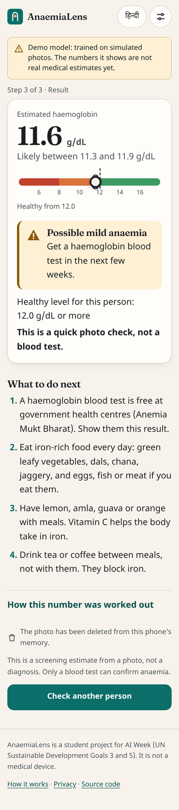
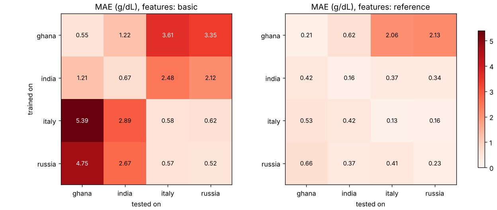

# 🩸 AnaemiaLens

**Anaemia screening from a phone photo: SDG 3 (Good Health) + SDG 5 (Gender Equality).**

57% of Indian women aged 15–49 are anaemic (NFHS-5), and testing usually needs a needle or a device. AnaemiaLens estimates haemoglobin from a photo of a fingernail using **linear regression written from scratch (y = mx + b)**, checks it against WHO cut-offs, and uses a **free local LLM (Ollama / llama.cpp)** to explain the result in simple English or Hindi. It needs no hardware, works offline, and keeps data private.

> ⚠️ Screening estimate only, not a diagnosis. The included results come from **simulated** photos and test the code, not real-world accuracy. See CLAUDE.md for how to run on real data.

## Quick start
```bash
python -m venv .venv && source .venv/bin/activate
pip install -r requirements.txt
python src/make_simulated_data.py                          # simulated photos from 4 regions
python src/progression.py --data data/simulated/labels.csv # y = mx + b → ... → final model, with checks
python -m pytest -q                                        # 49 tests
npm test                                                   # JavaScript tests
streamlit run app.py                                       # demo app
```

## Website
A full mobile web app in `web/`: it runs the model **in the browser** (no server), works **offline**, in **English and Hindi**, with a strict security policy so the photo cannot leave the phone.
```bash
python scripts/serve_web.py     # http://localhost:8000
```
Research, security, design and every file: [`docs/03_website_research.md`](docs/03_website_research.md).



## Docs
- [`CLAUDE.md`](CLAUDE.md): the teaching guide (ML basics, the maths, local LLMs, running, presenting).
- [`docs/01_problem_selection.md`](docs/01_problem_selection.md): why this problem (need, competition, data).
- [`docs/02_full_build_explained.md`](docs/02_full_build_explained.md): every file and function, the full process, the formulas.
- [`docs/03_website_research.md`](docs/03_website_research.md): the website's UX and security research, design and code.

## How it works
```
photo → colour features (nail + surrounding skin) → Hb = m₁x₁ + … + m₇x₇ + b → WHO category → local LLM explanation
```
The key experiment: a model trained only on lighter-skinned regions badly overestimates Hb on darker skin (it misses anaemia). Adding skin-reference features and training on diverse regions fixes most of that. See `reports/progression_log.md` after running.


