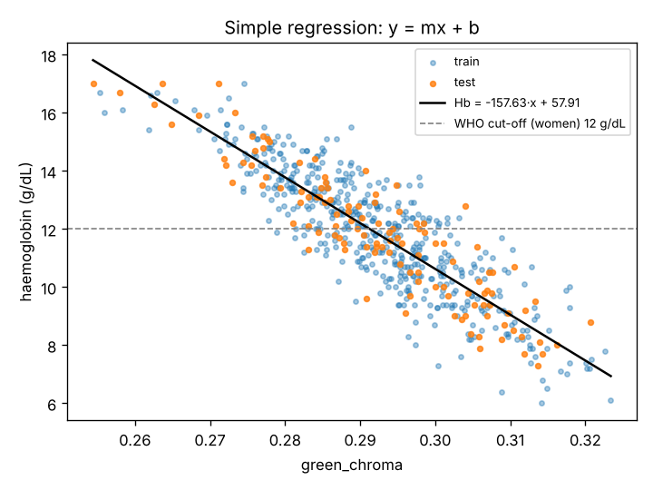
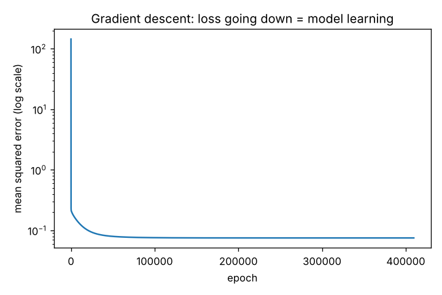
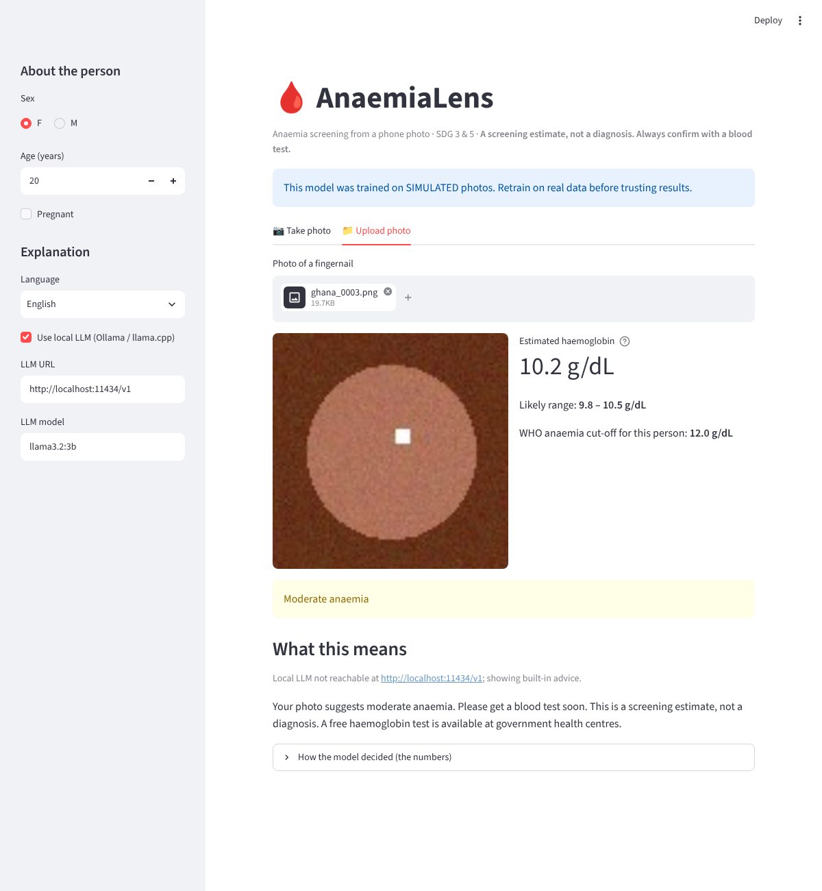

# AnaemiaLens: the full build, explained from nothing to a working app

This document explains **every part of the project**: what each piece is, what it does, **why it exists**, and **why it matters**. It also covers the maths behind `y = mx + b`, and the order we built and tested things in.

If you only remember one sentence: **we turn a photo into a few colour numbers, then use straight-line regression (y = mx + b) to turn those numbers into a haemoglobin estimate, and we test, test, test at every step until the results match what theory says.**

---

## Contents
0. [The big picture](#0-the-big-picture)
1. [The maths: y = mx + b, properly](#1-the-maths-y--mx--b-properly)
2. [The build order: stages 0 → 6](#2-the-build-order-stages-0--6)
3. [Every file and every function](#3-every-file-and-every-function)
4. [Testing: how we know it works](#4-testing-how-we-know-it-works)
5. [Getting real photos from several regions](#5-getting-real-photos-from-several-regions)
6. [The local LLM part (Ollama / llama.cpp)](#6-the-local-llm-part-ollama--llamacpp)
   - The website (`web/`) has its own document: [03_website_research.md](03_website_research.md)
7. [Honest limitations](#7-honest-limitations)
8. [Command cheat-sheet](#8-command-cheat-sheet)

---

## 0. The big picture

```
 PHOTO ──► features.py ──► 7 numbers ──► linear_regression.py ──► Hb estimate ──► evaluate.py ──► WHO category ──► local_llm.py ──► friendly advice
 (nail)    (measure colour)  (x values)    (y = m·x + b)            (g/dL)          (cut-offs)       (mild / severe)   (Ollama / llama.cpp)
```

| Question | Answer |
|---|---|
| **What goes in?** | A phone photo of a fingernail (or inner eyelid / palm), plus sex and age. |
| **What comes out?** | An estimated haemoglobin (Hb) in g/dL with a likely range, a WHO anaemia category, and plain-language advice in English, Hindi, etc. |
| **What is "the AI"?** | Two parts. (1) A **regression model** we wrote ourselves, which learns m and b from labelled photos; this is the machine learning. (2) A **local LLM**, which only explains the result in friendly words. The LLM never guesses Hb. |
| **Why regression and not "anaemic yes/no"?** | Hb is a **number**, and the anaemia cut-off depends on who you are (12 for women, 13 for men, 11 for pregnant women and small children). Predicting the number lets one model serve everyone. It is also the right shape for y = mx + b. |
| **Why should anyone trust it?** | Because of testing. Every stage has a **CHECK** that must pass, there are 40 automated tests, and we test on **regions the model never saw**. |

---

## 1. The maths: y = mx + b, properly

### 1.1 What the letters mean here
```
Hb  =  m  ×  redness  +  b
 y      m       x        b
```
- **x** is the *input* (feature): a number measured from the photo, e.g. how red the nail is.
- **y** is the *output* (target): haemoglobin in g/dL, measured in a lab for the training photos.
- **m** is the *slope*: how much Hb goes up when redness goes up by 1.
- **b** is the *intercept*: the Hb the line predicts when x = 0, which lifts the line up or down.

**Training** means finding the m and b that make the line pass as close as possible to all the training points.

### 1.2 What "as close as possible" means: the loss
For each photo *i* the line predicts ŷᵢ = m·xᵢ + b. The **error** is ŷᵢ − yᵢ. We square each error, so negatives can't cancel positives and big mistakes count extra, then take the average:

```
           1   n
Loss  =  ───  Σ  (m·xᵢ + b − yᵢ)²         ← "Mean Squared Error" (MSE)
           n  i=1
```
Smaller loss means a better line. **Training = finding m, b that make the loss as small as possible.**

### 1.3 Way 1: the exact formula (closed form, "least squares")
Calculus says the lowest point of the loss is where its slope (derivative) is zero in both m and b. Solving those two equations gives:

```
        Σ (xᵢ − x̄)(yᵢ − ȳ)
  m  =  ──────────────────          b  =  ȳ − m·x̄
          Σ (xᵢ − x̄)²
```
(x̄ = average of x, ȳ = average of y.)

**Intuition:** the top of the fraction asks *"when x is above its average, is y also above its average?"* The bottom scales that by how spread out x is. Then b makes the line go through the centre point (x̄, ȳ).

**Worked example (the one in Stage 0, by hand):**

| photo | x (redness) | y (Hb) | x − x̄ | y − ȳ | (x−x̄)(y−ȳ) | (x−x̄)² |
|---|---|---|---|---|---|---|
| 1 | 0.30 | 8.1 | −0.10 | −1.94 | 0.1940 | 0.0100 |
| 2 | 0.35 | 9.0 | −0.05 | −1.04 | 0.0520 | 0.0025 |
| 3 | 0.40 | 10.2 | 0.00 | +0.16 | 0.0000 | 0.0000 |
| 4 | 0.45 | 10.9 | +0.05 | +0.86 | 0.0430 | 0.0025 |
| 5 | 0.50 | 12.0 | +0.10 | +1.96 | 0.1960 | 0.0100 |
| | x̄ = 0.40 | ȳ = 10.04 | | | **Σ = 0.4850** | **Σ = 0.0250** |

m = 0.4850 / 0.0250 = **19.4**
b = 10.04 − 19.4 × 0.40 = **2.28**

**Hb = 19.4 × redness + 2.28.** A photo with redness 0.38 → 19.4 × 0.38 + 2.28 = **9.65 g/dL**.
The code (`fit_simple`) and NumPy's `polyfit` give exactly the same answer; that is Stage 0's check.

### 1.4 Way 2: gradient descent (how most ML actually learns)
The exact formula only works for simple cases. Neural networks and most ML instead **learn step by step**:

1. Start with a guess: m = 0, b = 0.
2. Measure the loss.
3. Work out which direction makes the loss go **down** (the gradient):
   ```
   ∂Loss/∂m = (2/n) Σ (m·xᵢ + b − yᵢ) · xᵢ
   ∂Loss/∂b = (2/n) Σ (m·xᵢ + b − yᵢ)
   ```
4. Take a small step that way:
   ```
   m ← m − α · ∂Loss/∂m
   b ← b − α · ∂Loss/∂b          (α = "learning rate", the step size)
   ```
5. Repeat. Each repeat is an **epoch**.

Picture standing on a foggy hill and wanting the bottom: feel which way is downhill, take a step, repeat.

**The learning rate α matters (Stage 1 experiment):**
| α | What happens | Why |
|---|---|---|
| 0.001 | Too slow: after 100 steps still far away | tiny steps |
| 0.1, 0.9 | Converges | good step size |
| 1.1 | **Diverges**: error explodes to ~10¹² | each step overshoots the valley and lands higher on the other side |

For one standardised feature, theory says the loss curvature is 2, so steps are stable only if α < 2/2 = **1**. Our experiment confirms that: 0.9 works and 1.1 explodes. **Theory predicted it; the test confirmed it.**

### 1.5 More than one feature: y = m₁x₁ + m₂x₂ + … + b
One colour number isn't enough, so we use 7:
```
Hb = m₁·red_chroma + m₂·green_chroma + m₃·log_red_green + m₄·brightness + m₅·saturation
     + m₆·skin_red_chroma + m₇·skin_log_red_green + b
```
It is the same idea with one slope per feature. In matrix form ŷ = X·m + b, and the exact answer is the **normal equation** m = (XᵀX)⁻¹Xᵀy. NumPy's `lstsq` solves it safely; we use it as the **referee** that gradient descent must match.

### 1.6 Standardisation (why we rescale features first)
`brightness` might range 0.3–0.9 while `red_chroma` ranges 0.40–0.46. With such different scales, one learning rate can't suit both. So before training, each feature is rescaled:
```
z = (x − mean) / standard_deviation        → every feature now has mean 0, spread 1
```
After training we **convert back** so the equation uses the real feature values:
```
slope_real = slope_z / std        intercept_real = b_z − Σ slope_z · mean / std
```
That is `LinearRegression.original_units()`.

### 1.7 Why gradient descent needed 256,000 epochs in Stage 3
`red_chroma`, `green_chroma` and `log_red_green` all measure nearly the same thing (redness), so they are strongly **correlated**. That turns the loss surface into a long, narrow, almost-flat valley. Gradient descent zig-zags slowly along it. That is why the **"test, and if it doesn't match, train longer"** loop (`fit_until_match`) needed 9 attempts (1,000 → 256,000 epochs) before the gap to the exact answer fell below 0.01 g/dL. It is also why the individual slopes look huge (e.g. −381 × green_chroma). Correlated features share the work in odd ways, but the **predictions** are still correct.

---

## 2. The build order: stages 0 → 6

`python src/progression.py --data data/simulated/labels.csv` runs all of this and writes `reports/progression_log.md`. Each stage ends with a **CHECK** that must PASS before we trust the next stage.

| Stage | What we did | The CHECK | Result (simulated data) |
|---|---|---|---|
| **0** | y = mx + b on 5 points, by hand and in code | code = pen-and-paper = NumPy | m = 19.4, b = 2.28 ✅ |
| **1** | Learn the same line by gradient descent; test → not matching → train longer → test again | GD = exact line | matched after 80 epochs (5 → 10 → 20 → 40 → 80) ✅ |
| **1b** | Learning-rate experiment | tiny = slow, too big = diverge | 0.001 slow, 0.1/0.9 OK, 1.1 diverged ✅ |
| **2** | y = mx + b on photos: pick the single most useful colour feature | beats "always guess the average" | MAE 1.85 → 0.76 g/dL ✅ |
| **3** | All basic colour features, gradient descent, test until it matches | GD = exact multi-feature answer | matched after 256,000 epochs ✅ |
| **4** | **Test on regions the model never saw** | expose the weakness | trained on Italy + Russia, tested on Ghana: **off by +4.7 g/dL, caught 0% of anaemia** ✅ (weakness found) |
| **5** | **Fix:** also measure the surrounding skin, then test again | cross-region error goes down | leave-one-region-out MAE 0.85 → **0.27**; Ghana sensitivity 0% → 61% (light-skin-only training) ✅ |
| **6** | Final model on all regions | screens well on held-out photos | MAE 0.26 g/dL, sensitivity 0.93, specificity 0.93 ✅ |

> ⚠️ All numbers above come from **simulated** photos. They prove the code and the method work. Real-photo accuracy will be **lower**, because real photos are messier than our simulation. Re-run on real data before you quote any number.

### Why Stage 4 is the most important stage
Most student and even published projects stop at Stage 3: "trained and tested on the same dataset, 92% accuracy!" Stage 4 asks the question that matters in the real world: **does it still work for people who look different from the training data?** In our simulation, a model trained only on lighter skin tells anaemic people with darker skin that they're fine. That isn't a small error; it's a **harmful bias**. Real studies found the same pattern (an Indian study found only 26% specificity; a US app had to be retrained for Bihar). Finding this, measuring it and reducing it is the core of the project.

### Why Stage 5's fix works
Skin pigment (melanin) and the phone camera's colour cast **multiply** every colour channel of the nail **and** the skin around it. Logarithms turn multiplication into addition:
```
log(R/G)_nail = log(R/G)_true nail colour + (pigment effect) + (camera effect)
log(R/G)_skin = log(R/G)_true skin colour + (bigger pigment effect) + (camera effect)
```
Giving the model both numbers lets it learn a combination where the shared effects **cancel out**, much as a photographer uses a white card to fix colour. It only learns this if the training data **includes a variety of skin tones**, which is why Stage 5 shows that diverse data matters as much as clever features.


*Left: colour-only features; dark red = big errors when the region changes. Right: with skin reference, errors are small everywhere except when training on one region alone.*

---

## 3. Every file and every function

### Folder layout
```
AI_week_model/
├── CLAUDE.md                     ← teaching guide + instructions for Claude Code
├── README.md                     ← quick start
├── app.py                        ← Streamlit demo app (camera / upload → result)
├── requirements.txt              ← Python packages to install
├── docs/
│   ├── 01_problem_selection.md   ← why we chose this problem (research + competition)
│   ├── 02_full_build_explained.md← this file
│   └── images/                   ← plots and app screenshot used in the docs
├── src/
│   ├── features.py               ← photo → colour numbers
│   ├── linear_regression.py      ← y = mx + b from scratch (3 ways)
│   ├── evaluate.py               ← error metrics + WHO anaemia cut-offs
│   ├── dataset.py                ← read labels.csv files, compute features for all photos
│   ├── train.py                  ← train + test + save the model
│   ├── cross_region.py           ← train in one region, test in another
│   ├── progression.py            ← the full stage 0 → 6 journey with checks
│   ├── predict.py                ← screen one photo from the command line
│   ├── local_llm.py              ← talk to Ollama / llama.cpp
│   ├── make_simulated_data.py    ← simulated multi-region photos for testing
│   ├── download_data.py          ← where/how to get REAL photos
│   └── prepare_dataset.py        ← turn a downloaded dataset into labels.csv
├── web/                          ← the website (runs the model in the browser) → docs/03
├── scripts/                      ← local web server with production headers, accessibility audit
├── tests/                        ← 49 pytest tests (incl. real-browser) + tests/web/ (Node)
├── data/      (not in git)       ← photos + labels.csv
├── models/    (not in git)       ← model.json (the learned m's and b)
└── reports/   (not in git)       ← plots, metrics, progression_log.md
```

### Shared data format: `labels.csv`
Every dataset is converted to the same simple table:
| column | required? | meaning |
|---|---|---|
| `image` | ✅ | path to the photo, relative to the CSV |
| `hb` | ✅ | lab-measured haemoglobin, g/dL (the **y** the model learns) |
| `sex`, `age` | optional | used to pick the right WHO cut-off |
| `pregnant` | optional | yes/no; changes the cut-off to 11.0 |
| `region` | optional | where the photo is from (ghana, india…), needed for cross-region tests |
| `mask` | optional | black/white image marking the nail/eyelid exactly |

**Why it matters:** each real dataset arrives in a different format. Converting them all to one format means the rest of the code never changes.

---

### `src/features.py`: photo → numbers
**Why it exists:** regression needs numbers, not pictures. This is the model's "eyes".

| Function | What it does | Why / why it matters |
|---|---|---|
| `load_rgb(path)` | Opens the photo, applies the phone's EXIF rotation, converts to RGB, shrinks it to ≤512 px, scales pixels to 0–1 | Phones save rotation separately (EXIF). Shrinking makes it fast, and averages barely change. 0–1 makes the maths clean. |
| `load_mask(path, h, w)` | Opens a black/white mask, resizes it to the photo | Some datasets (Eyes-defy-anemia) include hand-drawn outlines of the eyelid, which are more precise than guessing the centre. |
| `center_mask(h, w, 0.5)` | Marks the middle 50% of the image | Without a mask we assume the nail is in the middle (we tell users to centre it). |
| `border_mask(h, w, 0.12)` | Marks a thin frame around the edge | That frame is the **surrounding skin**, our colour reference (Stage 5). |
| `clean_pixels(pixels)` | Removes pixels that are too dark (shadow) or blown-out white (glare/flash reflection) | A shiny nail has white glare spots that aren't its real colour; leaving them in would wreck the average. A test checks that glare doesn't change the result. |
| `color_stats(pixels)` | Computes 5 numbers (below) | These are the **x values** in y = mx + b. |
| `extract_features(path, mask, crop)` | Runs everything: target-region stats + skin-border stats → dict of 7 features | One call per photo. Refuses photos that are too dark (ValueError) instead of guessing. |

**The features, and why each one:**
| Feature | Formula (per pixel, then averaged) | Why |
|---|---|---|
| `red_chroma` | R / (R+G+B) | Share of light that is red. Haemoglobin is red, so less Hb means a paler, less red nail bed. Dividing by the total cancels **brightness** (a dim photo has the same chroma), and a test checks this. |
| `green_chroma` | G / (R+G+B) | Haemoglobin absorbs green light strongly, so more Hb means less green. In the simulation it was the single best feature (negative slope). |
| `log_red_green` | log(R / G) | Redness relative to green. The log turns multiplicative effects (camera, pigment) into additive ones, so a linear model can subtract them. |
| `brightness` | (R+G+B)/3 | Overall light level. Helps the model spot under- or over-exposed photos. |
| `saturation` | (max−min)/max | How "colourful" versus washed-out the colour is; pale nails are less saturated. |
| `skin_red_chroma` | red_chroma of the border | Reference: how red the person's **skin** is (pigment + camera). |
| `skin_log_red_green` | log(R/G) of the border | Reference for cancelling skin tone and colour cast. |

`blue_chroma` is **deliberately left out**: red + green + blue chroma always add up to 1, so blue adds no new information and would make the maths unstable.

---

### `src/linear_regression.py`: the learning
**Why it exists:** this is the machine learning. It is written from scratch with NumPy so nothing is hidden.

| Function / class | What it does | Why / why it matters |
|---|---|---|
| `fit_simple(x, y)` | The exact one-feature formula from §1.3 → (m, b) | The purest form of y = mx + b. Used in Stages 0 and 2, and for the "simple model" in the app. Refuses if all x are equal (you can't get a slope from a vertical stack of points). |
| `fit_least_squares(X, y)` | Exact multi-feature answer with `np.linalg.lstsq` | The **referee**: gradient descent must match it. Adds a column of 1s so the intercept b is learned like any other slope. |
| `LinearRegression(learning_rate, epochs, tolerance)` | Gradient-descent model | How real ML learns (§1.4). |
| `.fit(X, y)` | Standardises X → starts at 0 → loops: predict, error, loss, gradient, step | Records `loss_history_` for the loss-curve plot. Sets `diverged_` and stops if the loss explodes (learning rate too big). Optional `tolerance` stops early when progress stalls. |
| `.predict(X)` | Applies the learned equation to new rows | Uses the same mean/std as training. Mixing scales here is a classic bug. |
| `.original_units()` | Converts slopes back to real feature units (§1.6) | So we can print a readable equation: Hb = 103.8 × red_chroma + … |
| `.to_dict()` / `from_dict()` | Saves and loads the model as plain numbers in JSON | The whole "trained AI" is just these few numbers in `models/model.json`. |
| `LinearRegression.from_exact(X, y)` | Builds the same kind of model from the exact solver | Used for fast experiments (cross-region runs dozens of fits) **after** we proved GD matches the exact solution. |
| `fit_until_match(X, y, …)` | **Train → test against exact → if gap > tolerance, double epochs → repeat** | This is "testing, testing, testing until it matches", built into the code. Returns every attempt so we can show the progression. |

---

### `src/evaluate.py`: is it any good?
**Why it exists:** "It runs" is not the same as "it works". These numbers decide.

| Function | What it does | Why / why it matters |
|---|---|---|
| `who_threshold(sex, age, pregnant)` | Returns the WHO Hb cut-off: child <5 → 11.0, 5–11 → 11.5, 12–14 → 12.0, woman → 12.0, pregnant → 11.0, man → 13.0 | Anaemia **means different numbers for different people**. Using one cut-off for everyone would mislabel men and children. |
| `severity(hb, threshold)` | WHO bands: no / mild / moderate / severe anaemia | Tells the user how urgent it is. Severe means see a doctor today. |
| `regression_metrics(true, pred)` | **bias**, **MAE**, **RMSE**, **R²** | See below. |
| `screening_metrics(true, pred, thresholds)` | Counts true/false positives/negatives → **sensitivity**, **specificity**, accuracy | A screening tool is judged by **how many sick people it catches**, not by average error. |

**What each metric means:**
| Metric | Meaning | Good value |
|---|---|---|
| **bias** | Average of (predicted − true). **+** means it guesses too high, so it misses anaemia. | close to 0 |
| **MAE** | Average size of the error in g/dL. "Typically off by 0.7 g/dL." | small |
| **RMSE** | Like MAE but punishes big mistakes more. We use it as the ± range shown to users. | small |
| **R²** | Fraction of the Hb differences between people that the model explains. 1 = perfect, 0 = no better than guessing the average, negative = worse than guessing. | close to 1 |
| **Sensitivity** | Of the people who **are** anaemic, how many did we flag? | high (≥0.85). Missing anaemia is the dangerous error. |
| **Specificity** | Of the people who are **not** anaemic, how many did we correctly clear? | high. Too many false alarms waste people's trust and time. |

---

### `src/dataset.py`: loading data
| Function | What it does | Why |
|---|---|---|
| `load_table(csv_paths)` | Reads one or more `labels.csv`, runs `extract_features` on every photo, adds the WHO cut-off, skips unreadable photos with a message | Lets us combine **several regions** in one call. If there's no `region` column, the folder name is used, so data never loses its origin. |
| `is_yes(value)` | Reads yes/1/true as True and blanks as False | Spreadsheets store yes/no in many ways; an empty cell must not count as "pregnant". |
| `region_counts(table)` | {'ghana': 150, …} | For printing. |

### `src/train.py`: train once, properly
`python src/train.py --data data/simulated/labels.csv [--test-data other_region/labels.csv] [--features basic|reference]`

| Function | What it does | Why |
|---|---|---|
| `split(table, 0.2, seed)` | Shuffles and keeps 20% aside as the **test set** | The model must be judged on photos it **never saw**, otherwise it can just memorise. The fixed seed makes results repeatable. |
| `correlations(train, features)` | Correlation (−1…+1) of each feature with Hb, **training data only** | Picks the best single feature for y = mx + b. Using test data here would be cheating (data leakage). |
| `train_models(...)` | Fits the simple model and the multi-feature model (with `fit_until_match`) | Keeps both so we can show the improvement. |
| `predictions` / `evaluate_models` | Baseline vs simple vs multi on the test set | The **baseline** (always guess the training average) is the bar to beat. A model that can't beat it has learned nothing. |
| `save_plots(...)` | `fit_line.png`, `loss_curve.png`, `pred_vs_true.png` | Pictures for the presentation and for spotting problems. |
| `main()` | Ties it together, saves `models/model.json` and `reports/metrics.json` | `--test-data` makes it a **cross-population test** (train on Ghana, test on India). |




### `src/cross_region.py`: does it travel?
| Function | What it does | Why |
|---|---|---|
| `fit_and_score(train, test, features)` | Exact fit + all metrics | One building block for many experiments. |
| `leave_one_region_out(table, features)` | For each region: train on all the others, test on it | Simulates "we deploy in a new place". |
| `region_matrix(table, features)` | Train on A only, test on B, for every pair (diagonal uses an 80/20 split) | Shows which regions "travel" to which. |
| `format_loro`, `format_matrix`, `plot_matrices` | Tables and a heatmap | For the report and the slides. |

### `src/progression.py`: the whole journey
Runs stages 0 → 6 (§2). The `Log` class prints each line **and** saves it to `reports/progression_log.md`. `log.check(name, passed, detail)` records PASS/FAIL. The summary table at the end must be all PASS.

### `src/predict.py`: screen one photo
`python src/predict.py photo.jpg --sex F --age 19 --language Hindi`
| Function | What it does | Why |
|---|---|---|
| `screen(image, model_info, sex, age, pregnant, mask, simple)` | features → Hb → ± range (from test RMSE) → WHO cut-off → severity | Shared by the command line **and** the app, so both always agree. `--simple` uses the one-feature y = mx + b model. |
| `main()` | Prints the result, then the LLM explanation (or built-in text with `--no-llm`) | Always prints the "screening only" warning. |

### `src/local_llm.py`: the friendly explanation
See §6.

### `src/make_simulated_data.py`: test data before real data
Creates 96×96 images of a nail (an ellipse) surrounded by skin, with a known Hb. Each region has:
| region | skin pigment (melanin) | camera colour cast | typical Hb |
|---|---|---|---|
| ghana | high (0.9–1.6) | slightly warm | 10.2 ± 1.8 (children) |
| india | medium (0.5–1.2) | neutral | 11.0 ± 2.0 (women) |
| italy | low (0.0–0.5) | slightly cool | 12.6 ± 1.8 (adults) |
| russia | low (0.0–0.4) | slightly cool | 13.2 ± 1.7 (adults) |

Melanin is modelled the physical way: it absorbs blue and green more than red (`MELANIN_ABSORPTION = [0.6, 1.0, 1.4]`), affecting skin strongly and the nail bed only lightly (25%). Random lighting, sensor noise and a glare spot are added.
**Why it matters:** it lets us test the *whole* pipeline, including the cross-region problem, before real data arrives. **Why it's not evidence:** we wrote the rules that made the photos, so of course a model can learn them. Real photos are messier.

### `src/download_data.py`: where real data lives
`python src/download_data.py --list` shows 5 datasets from 4 regions with page, citation and Kaggle command. `--get NAME` tries an automatic download, and prints manual steps if the host needs a browser or login.

### `src/prepare_dataset.py`: convert any dataset to `labels.csv`
Matches each spreadsheet row to its photo (by file name **or** name without extension, so "IMG_001" finds "IMG_001.jpg"). It also prints the spreadsheet's column names so you can pick `--hb-col` etc. Rows with no photo or no Hb are skipped and counted.

### `app.py`: the demo
`streamlit run app.py`: sidebar for sex / age / pregnancy / language / LLM settings, a **camera** tab and an **upload** tab. It shows the Hb, likely range, cut-off, a coloured severity box, the LLM explanation, and an expander with the raw numbers and the y = mx + b equation. It warns if the model was trained on simulated photos.



### `tests/`: automated checks
See §4.

---

## 4. Testing: how we know it works

Three layers of testing:

**1. Stage checks** (`progression.py`). These are "does the method behave like the theory says?" (§2). All 9 PASS.

**2. Unit tests** (`pytest`, 49 tests including the website's parity and real-browser tests; plus `npm test` for JavaScript). Each component is tested on its own:
| File | What it proves |
|---|---|
| `test_linear_regression.py` | finds a perfect line exactly; matches the hand example (19.4, 2.28); GD = exact solver; loss goes down; too-big learning rate is flagged as diverged; `fit_until_match` retries with growing epochs until it matches; saving and loading gives identical predictions |
| `test_features.py` | redder photo → higher red_chroma; dim vs bright photo → same chroma; glare ignored; black photo rejected; skin features come from the border; masks work |
| `test_evaluate.py` | every WHO cut-off and severity band; perfect predictions give MAE 0 / R² 1; bias sign; sensitivity/specificity counted correctly on a tiny hand example |
| `test_prepare_dataset.py` | a spreadsheet row finds its photo with or without the file extension; rows with missing photos are skipped; region is written; paths work from the CSV's folder |
| `test_pipeline.py` | end to end: simulate photos → load → train → beats baseline → screen one photo → sensible output; skin reference helps across regions; app still works when no LLM is running |

**3. Real-world checks** (you do these with real data): cross-region tests (`cross_region.py`), then trying the app on volunteers whose Hb was just measured at a camp or clinic, with consent.

Run everything:
```bash
python -m pytest -q          # 49 passed
npm test                     # JavaScript tests
python src/progression.py --data data/simulated/labels.csv   # all checks PASS
```

---

## 5. Getting real photos from several regions

| Dataset | Region | Body part | Size | Labels |
|---|---|---|---|---|
| Ghana fingernails (Mendeley) | 🇬🇭 Ghana | fingernail | see page (children ≤5 y) | Hb, age, sex |
| Ghana palm (Mendeley) | 🇬🇭 Ghana | palm | see page | Hb, age, sex |
| Ghana conjunctiva (Mendeley) | 🇬🇭 Ghana | inner eyelid | 710 | anaemic label / Hb |
| Eyes-defy-anemia (IEEE DataPort / Kaggle) | 🇮🇳 India + 🇮🇹 Italy | inner eyelid **+ masks** | 95 + 123 | Hb, age, sex |
| Yakimov et al. 2024 (Scientific Data) | 🇷🇺 Russia | fingernail + hand skin | see paper | Hb |

Steps (in your **GitHub Codespace or laptop**, which have normal internet; the build container used here could not reach these sites):
```bash
python src/download_data.py --list                 # see everything
python src/download_data.py --get ghana_nails      # tries automatic, else prints manual steps
# Kaggle (needs a free Kaggle account + API token in ~/.kaggle/kaggle.json):
pip install kaggle
kaggle datasets download -d harshwardhanfartale/eyes-defy-anemia -p data/raw/eyes_defy_anemia --unzip

# Convert each to labels.csv (column names: open the spreadsheet and check):
python src/prepare_dataset.py --images-dir data/raw/ghana_nails --sheet data/raw/ghana_nails/<sheet>.xlsx \
    --image-col <photo column> --hb-col <Hb column> --sex-col <sex column> --age-col <age column> \
    --region ghana --out data/ghana_nails/labels.csv

# Then the same journey on real data, all regions together:
python src/progression.py --data data/ghana_nails/labels.csv data/india/labels.csv data/italy/labels.csv
python src/cross_region.py --data data/ghana_nails/labels.csv data/india/labels.csv data/italy/labels.csv
```
Things to watch with real data:
- **Body parts:** don't mix nails and eyelids in one model; train one model per body part.
- **Eyes-defy-anemia** has one folder per patient, with the photo and mask files; you may need to set the `mask` column. Ask Claude Code to adapt `prepare_dataset.py` after downloading (CLAUDE.md tells it how).
- **Ghana sets are children under 5.** Their cut-off is 11.0, and their Hb range differs from adult women's. Say so when comparing regions.
- **Licences:** read each dataset's licence and **cite it** on your slides.

---

## 6. The local LLM part (Ollama / llama.cpp)

**Role:** turn `Hb 9.6 g/dL, cut-off 12, moderate anaemia` into kind, simple advice, in Hindi or another language if wanted.
**Not its role:** guessing Hb or diagnosing. LLMs can sound confident while being wrong ("hallucinate"), so the **number always comes from our tested regression model**, and the LLM is only told that number.

How `local_llm.py` works:
| Piece | What / why |
|---|---|
| `SYSTEM_PROMPT` | Rules for the LLM: say it's an estimate; always advise a blood test (free at government centres under Anemia Mukt Bharat); severe means see a doctor today; iron-rich local foods + vitamin C; **no medicine names or doses**; ≤120 words; simple language; requested language. These are **safety guardrails**. |
| `explain(result, language, base_url, model)` | Sends a POST to `<base_url>/chat/completions` with the system prompt + the result. `temperature 0.3` keeps it calm and consistent. |
| `fallback_explanation(result)` | Fixed, safe text used when no LLM is running, so the app **never breaks** in a demo. |
| `explain_or_fallback(...)` | Tries the LLM, otherwise uses the fallback, and tells you which happened. |

Both **Ollama** and **llama.cpp's `llama-server`** speak the same "OpenAI-style" chat API, so one function serves both:
| Server | Default URL | Start it |
|---|---|---|
| Ollama | `http://localhost:11434/v1` | `ollama pull llama3.2:3b` then the app (Ollama runs in the background) |
| llama.cpp | `http://localhost:8080/v1` | `llama-server -m model.gguf --port 8080` |

Change server or model without code: `export LLM_BASE_URL=http://localhost:8080/v1` and `export LLM_MODEL=gemma3:4b`, or use the app's sidebar. Full setup is in CLAUDE.md.

---

## 7. Honest limitations
1. **No real-photo results yet.** Every number in this repo comes from simulated photos. Say so clearly until you've re-run on real data.
2. **Small real datasets** (hundreds, not thousands) mean results will vary. Report ranges, not one lucky number.
3. **Linear model.** A straight line can't capture everything. That's a deliberate trade-off: it's explainable, fast, runs on any phone, and you can show the equation. A CNN might be more accurate but is a black box. A good "future work" slide: compare against a small CNN.
4. **Photo conditions.** Nail polish, henna, cold fingers, flash and very dim light all change colour. The app asks for daylight and no polish.
5. **Not a medical device.** Screening only. Never let it replace a blood test.

---

## 8. Command cheat-sheet
```bash
# setup (once)
python -m venv .venv && source .venv/bin/activate
pip install -r requirements.txt

# simulated data → full journey → tests
python src/make_simulated_data.py                       # 600 photos, 4 regions
python src/progression.py --data data/simulated/labels.csv
python src/cross_region.py --data data/simulated/labels.csv
python src/train.py --data data/simulated/labels.csv    # one training run with plots
python -m pytest -q

# use it
python src/predict.py data/simulated/images/ghana_0003.png --sex F --age 20
python src/predict.py photo.jpg --language Hindi        # needs Ollama running
streamlit run app.py                                    # demo app in the browser
```
