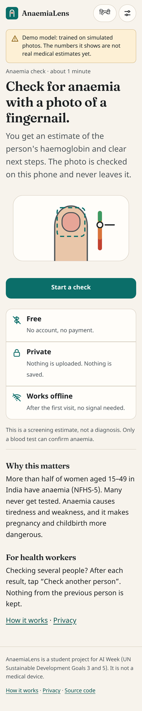
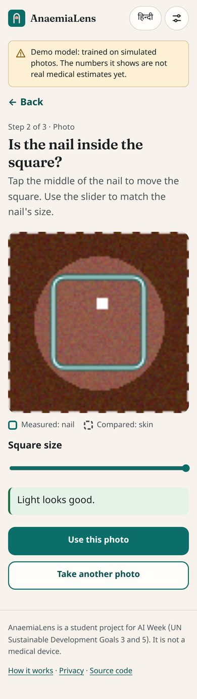
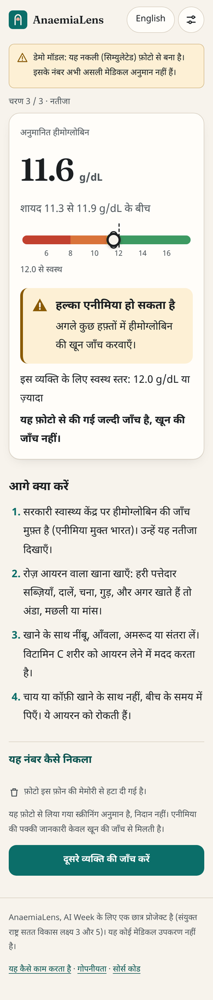

# The AnaemiaLens website: research, decisions and how it works

A usable MVP website for the anaemia check. It runs **entirely on the phone**, works **offline**, is available in **12 Indian languages** (English and Hindi built in, 10 more loaded when chosen), and is locked down so the photo **cannot** leave the device.

**Version 2** added an animated opening page, optional on-device accounts protected by a PIN, 10 more languages (including right-to-left Urdu) and a two-column layout for wide screens. All of that is explained in [§11](#11-version-2-the-opening-page-accounts-languages-and-landscape-layout); sections 1–10 describe the base app and have been corrected where version 2 changed them.

Contents:
1. [The core decision: everything on the device](#1-the-core-decision-everything-on-the-device)
2. [UX research → what we built](#2-ux-research--what-we-built)
3. [Security research → what we built](#3-security-research--what-we-built)
4. [Visual design](#4-visual-design)
5. [Every file, explained](#5-every-file-explained)
6. [Testing: how we know it works](#6-testing-how-we-know-it-works)
7. [Running and deploying](#7-running-and-deploying)
8. [Using a local language model with the website](#8-using-a-local-language-model-with-the-website)
9. [Limits and next steps](#9-limits-and-next-steps)
10. [Sources](#10-sources)
11. [Version 2: the opening page, accounts, languages and landscape layout](#11-version-2-the-opening-page-accounts-languages-and-landscape-layout)
12. [The desktop app (Electron)](#12-the-desktop-app-electron)

---

## 1. The core decision: everything on the device

| Option | Security | Privacy | Works offline | Cost |
|---|---|---|---|---|
| Upload the photo to a server, which runs the model | A server to attack and patch; health photos stored somewhere | Photos leave the phone | ✗ | Hosting |
| **Run the model in the browser (chosen)** | **No server code at all; nothing to break into** | **The photo never leaves the phone** | **✓** | **Free static hosting** |

This is possible because our model is tiny: the whole "trained AI" is **8 numbers** (7 slopes + 1 intercept) in `web/model.json`. JavaScript measures the photo's colours and applies `Hb = m₁x₁ + … + m₇x₇ + b`, the same equation Python learned.

**The catch:** the browser must compute *exactly* the same features as Python, or the learned m's and b would be applied to the wrong numbers. So `web/js/features.js` is a line-by-line port of `src/features.py`, and a test (`tests/test_web_parity.py`) feeds identical pixels to both and requires the features to agree to 0.000000001 and the Hb to 0.000001.

---

## 2. UX research → what we built

Research covered existing anaemia apps (Mannino et al. 2018, Sanguina, EzeCheck, Purdue's eyelid app), risk-communication studies, low-literacy design in India, GOV.UK and NHS design systems, and WCAG 2.2. Each finding is listed with the feature it led to.

| Research finding | What we built |
|---|---|
| Low-literacy users in India find typing and dropdowns hard; picture + text works (Medhi et al., Microsoft Research; CHW studies in Chhattisgarh) | **No typing anywhere in a check.** Big tap targets with icons + words. Age is chosen from **5 age groups**, not typed. (Only the optional account asks for a name and a PIN.) |
| GOV.UK pattern: **one question per screen** | Sex → age group → pregnancy, each on its own screen with a Back button and "Step 1 of 3". |
| Ask only questions that apply | Pregnancy is asked **only** for women aged 15–49. "Not sure" uses the stricter non-pregnant cut-off, which flags more people rather than fewer. |
| The Mannino fingernail app has the user **tap the nail after taking the photo** | **Confirm screen:** tap the nail to move the square, use a slider to fit it, and the overlay shows exactly what is measured (nail) and what is compared (skin). |
| Bare nails, same lighting every time, no flash glare (AnemoCheck, clinical protocols) | **Illustrated tips screen** before the camera opens: daylight/no flash, bare nail, warm relaxed hand, fill the square. |
| Check photo quality and give a specific retake reason | Live **quality check**: "too dark → move to a window", "too bright", "shiny reflection → tilt your finger". Photos the model can't measure are refused, not guessed. |
| Live preview with an on-screen guide is best; always keep fallbacks (web.dev) | Live camera with a **guide square** (rear camera), plus "Use phone camera app" (`capture="environment"`) and "Choose a photo". A blocked camera gets a clear message and these alternatives. |
| Show **a number with a range** (Winton Centre: ranges don't lose trust; vague caveats do) | "**11.7 g/dL**, likely between 11.0 and 12.3". |
| A **number line with labelled bands** helps people judge how serious a result is (JMIR 2018) | A Hb scale coloured with **this person's** WHO bands (severe / moderate / mild / healthy), the estimate as a dot, the range as a bracket and the cut-off as a dashed line. |
| Never use colour alone (WCAG 1.4.1) | Every category has **colour + icon shape + words**: ✓ circle (none), ▲ triangle (borderline/mild/moderate), ⯃ octagon (severe). |
| Avoid false reassurance | "No sign" still says **"a photo check cannot rule anaemia out"**. If the likely range crosses the cut-off, the result is **"Borderline — get a blood test"**. |
| Put "screening, not diagnosis" next to the result, not only on a splash screen | A boxed line, **"Screening estimate, not a diagnosis. Get a blood test."**, is **inside the result card**, right under the number line. |
| NHS-style action cards that match urgency | "What to do next": free blood test (Anemia Mukt Bharat), iron foods, vitamin C, tea timing. Severe says **"see a doctor or nurse today"**. |
| Plain language, reading age 9–11 (NHS, CDC Clear Communication Index) | Short sentences, everyday words ("haemoglobin is what makes blood red"). |
| Hindi needs line-height ≥ 1.6–1.8 and body ≥ 18px (India's UX4G design system); self-host Noto Devanagari | **Noto Sans Devanagari** self-hosted, 17px body (16px on phones) with large headings and buttons, **line-height 1.8** for Hindi, international digits ("11.7"). |
| Privacy claims must be **checkable**, not just stated (CHI 2025) | Works in **airplane mode** (tested); "the photo has been deleted" shown on the result; privacy page explains how to check it yourself. |
| No accounts for emergent users | A check **never** needs sign-up or login. Version 2 adds **optional** accounts for people who want a history (§11.7); "Start a check" still skips them entirely. |
| ASHA (community health worker) workflow: screen many people in a row | **"Check another person"** jumps straight back to the first question; nothing from the previous person is kept. |
| WCAG 2.2: targets ≥ 24px (we use 48px+), visible focus, status messages, reduced motion | 44–80px targets, 2px amber focus rings, a `role="status"` region announces the result, and with reduced motion every animation shows its finished, still state (§11.6). |
| Dark mode: follow the system, check contrast in both themes | Version 4 ("Kinetic Reveal", §11.15) keeps the opening page **dark** and the check screens **cream** in both system themes; version 3 ("Night Desk", §11.12) was **dark in both system themes**, by the owner's choice; `color-scheme: dark` keeps form controls dark too. **axe-core reports 0 violations** on every screen with the system in light and in dark mode, in English and Hindi. |
| Credibility: say who made it, show honest accuracy and limits (Stanford Web Credibility) | `privacy.html`: who made it, data used, **honest accuracy (simulated, so real accuracy is not yet known)**, limits. |
| Avoid the generic "AI look": purple gradients, sparkles, three-card grids | No sparkles, no purple, no "AI-powered" wording, no template card grid. The look is a lab desk at night: ink, one warm lamp, hairline rules and monospace readouts (§4, §11.12). |

---

## 3. Security research → what we built

Threat model: there is no server, so the risks are **(a)** code injection in the page (XSS), **(b)** the photo or result leaking to a third party, **(c)** clickjacking (the site loaded invisibly inside another site), **(d)** malicious or broken files, **(e)** a hostile reply from the language model, and **(f)** supply-chain attacks (someone else's script turning bad).

| Risk | Defence | Where |
|---|---|---|
| Data leaving the device | **CSP `connect-src`** lists only this site and `localhost` ports for Ollama / llama.cpp. The **browser itself** blocks any other request. | `_headers`, `<meta>` in `index.html` |
| Script injection (XSS) | **CSP `script-src 'self'`**, no inline scripts, no `eval`. **Trusted Types** required: any write to `innerHTML` etc. throws. The code sets text with `textContent` only. | CSP, `js/dom.js` |
| Malicious LLM reply | Shown with `textContent` only, so HTML is never parsed. A test proves a reply containing `` and `<script>` shows as plain text and never runs. The length is capped and requests time out. | `js/explain.js`, `tests/test_web_e2e.py` |
| LLM address pointed at another machine | Only `localhost` / `127.0.0.1` allowed (checked in code **and** by the CSP). Only numbers are sent, never the photo. | `safeEndpoint()` |
| Clickjacking | `frame-ancestors 'none'` + `X-Frame-Options: DENY`; JS refuses to run inside a frame (for hosts without headers). | `_headers`, `app.js` |
| Malicious / huge image files ("decompression bombs") | File type checked from its **first bytes**, not its name; dimensions read from the **header before decoding**; limits of 15 MB and 40 megapixels; large photos shrunk before processing. | `js/image.js` |
| Tampered model file | `validateModel()` checks shapes, finite numbers, known feature names and positive std before use. | `js/model.js` |
| Supply-chain attacks | **Zero runtime dependencies**: no frameworks, CDNs, analytics or Google Fonts. Fonts are self-hosted (OFL). Embedding Google Fonts was ruled a GDPR breach in Germany (LG München 2022), and polyfill.io turned malicious in 2024. | whole site |
| Camera / mic / location misuse | `Permissions-Policy`: camera for this site only; microphone, location, payment, USB etc. disabled. The camera stops the moment the photo is taken (tested). | `_headers`, `camera.js` |
| Referrer and cross-origin leaks | `Referrer-Policy: no-referrer`, `nosniff`, COOP / CORP / COEP same-origin, HSTS. | `_headers` |
| Saved history read by someone else on the phone (version 2) | Accounts are optional. History is encrypted with **AES-256-GCM**; the key is made from the PIN with **PBKDF2-SHA256, 600,000 rounds** and is non-extractable; the PIN is never stored; growing waits after 5 wrong PINs; auto-lock. Honest limit: a short PIN can be brute-forced from a copy of the storage. | `js/accounts.js`, `js/account-ui.js`, §11.7 |
| Offline cache poisoning | The service worker only caches same-origin GET responses of type `basic`, never `localhost` LLM calls. The cache is versioned and old caches are deleted. | `sw.js` |

**The full header set** is in `web/_headers` (Netlify and Cloudflare Pages apply it). GitHub Pages cannot send custom headers, so each page also carries a `<meta>` CSP. `frame-ancestors`, `Permissions-Policy` and `nosniff` only work as real headers, which is why Netlify or Cloudflare Pages is the most secure place to host.

Not used, on purpose: `upgrade-insecure-requests`, which would break `http://localhost` calls in some browsers.

---

## 4. Visual design

Version 1 aimed at "trustworthy health service", modelled on GOV.UK and NHS: warm paper, near-black ink, teal buttons. Version 3 (§11.12) replaced that look with **"Night Desk"**, the design the student picked from four mockups. **Version 4 (§11.15), "Kinetic Reveal", is the current look**; the description below is Night Desk's, kept for the record. The health-service rules underneath did not change.

- **The idea:** a lab desk at night. An ink-blue, near-black ground (`#080B11`), one pool of warm **amber lamp light**, a **blush** accent taken from the nail colour, and instruments laid on the desk: a specimen panel, a number line, a log.
- **Colour rules:** **amber is used for actions** (every main button) and for "this is what we measure" (the dashed square, the cut-off line). **The four WHO colours (red, orange, amber, sage green) are used only for result severity**, always with an icon shape and words, so colour is never the only signal. Every text colour is checked against the ink for WCAG AA contrast.
- **Type:** *Fraunces* (a characterful serif, plus its italic for the opening headline, shaded amber → blush) for English headings and big numbers; *Noto Sans Devanagari* for body text, Hindi and Marathi; the phone's own **monospace** font for readouts, formulas and tick labels, with tabular numbers so digits line up. Small labels are UPPERCASE with wide letter spacing (not in Indian scripts, which have no capitals). Fonts are self-hosted (about 166 KB). The other Indian scripts and Urdu use the phone's own fonts (§11.8).
- **Structure:** hairline rules instead of boxes and shadows; on the opening page every section has a **§ number and a label in a left margin**, like a lab notebook.
- **Signature elements:** the **specimen panel** (one simulated photo, its colour numbers and its estimate) and the **Hb number line** with a dashed WHO cut line, used on the opening page, in the scroll story and on the result.
- **Not used:** sparkles, emoji, purple, "AI-powered" wording, glass effects, third-party fonts or icons.

Screenshots below are from version 1 (the old paper look); §11.12 describes the current Night Desk screens.

| Home (version 1) | Confirm the nail | Result | Result (Hindi) |
|---|---|---|---|
|  |  |  |  |

All screenshots (light/dark, English/Hindi, every screen) can be regenerated by the browser tests: `SCREENSHOT_DIR=shots python -m pytest tests/test_web_e2e.py`.

---

## 5. Every file, explained

```
web/
├── index.html            the whole app: every screen is a <section>, shown one at a time
├── privacy.html          privacy, accounts, languages, honest accuracy, limits, who made it
├── _headers              security headers for Netlify / Cloudflare Pages
├── manifest.webmanifest  makes it installable ("Add to home screen")
├── sw.js                 service worker: offline cache
├── model.json            the trained model (8 numbers + metadata), from src/export_web_model.py
├── css/styles.css        all styling ("Kinetic Reveal": loud dark opening, calm cream check), every language, opening-page animations
├── img/                  specimen-india-0062.png: the simulated photo shown as the example specimen
├── fonts/                self-hosted fonts + their licences
├── icons/                app icons
└── js/
    ├── app.js            screen flow, questions, photo confirm, result rendering, settings
    ├── intro.js          the opening page: marquee, live red cells, the 3D phone, 100-women grid, the pinned reveal, sideways panels, chart (§11.15)
    ├── scale.js          the Hb number line (WHO bands, estimate, range, dashed cut-off), shared by every screen
    ├── accounts.js       on-device accounts: PIN → key, encrypted history, wrong-PIN waits
    ├── account-ui.js     sign-in, create-account and "your checks" screens, auto-lock
    ├── features.js       photo pixels → 7 colour numbers (port of src/features.py)
    ├── model.js          y = m·x + b prediction, WHO cut-offs, severity, model validation
    ├── image.js          safe file checks, decoding, cropping, quality check
    ├── camera.js         live camera, guide square → photo pixels
    ├── explain.js        optional local-language-model explanation
    ├── i18n.js           every word of the interface in English and Hindi, + the language list
    ├── lang/             the other 10 languages, one file each (bn, mr, te, ta, gu, ur, kn, or, ml, pa)
    ├── dom.js            tiny helpers: textContent-only, safe localStorage
    └── register-sw.js    registers the service worker through a Trusted Types policy
```

### `js/features.js`: why it must match Python exactly
| Function | What / why |
|---|---|
| `centerMask`, `borderMask` | The middle 50% of the crop is "nail"; a 12% frame around the edge is "skin". These are the same regions as `src/features.py`. Python's `int()` = JS `Math.floor` for positive numbers; getting this wrong shifts the region by a pixel. |
| `colorStats` | Averages red/green chroma, log(R/G), brightness and saturation over the pixels, skipping shadow (mean < 0.08) and glare (max ≥ 0.98), with the same EPS = 1e-6 as Python. |
| `extractFeatures` | Returns the 7 features. Refuses photos with fewer than 50 usable nail pixels (`PhotoQualityError`) instead of guessing. |
| `fitWithin` | Shrinks to ≤ 512 px like PIL's `thumbnail`. |

### `js/model.js`
| Function | What / why |
|---|---|
| `validateModel` | `model.json` is data loaded over the network, so it's checked before use: feature names must be known ones, arrays must have matching lengths, and every number must be finite, with std > 0. |
| `predictHb` | `Hb = b + Σ ((x − mean)/std) × w`: exactly `LinearRegression.predict` in Python. |
| `whoThreshold`, `severity` | Copies of `src/evaluate.py` (tested against the same cases). |
| `screen` | Hb, range (± the model's test RMSE), cut-off and category. |

### `js/image.js`
| Function | What / why |
|---|---|
| `sniffType` | Reads the first bytes (`FF D8 FF` = JPEG, `89 50 4E 47` = PNG, `RIFF…WEBP`). A text file renamed `.png` is refused. |
| `readDimensions` | Reads width × height from the PNG IHDR, JPEG SOF or WebP header **without decoding**, to refuse decompression bombs. |
| `decodeFile` | Size and type checks → `createImageBitmap` (which applies the phone's EXIF rotation) → shrink to ≤ 2048 px. |
| `cropRegion` | Cuts the square around the nail (twice the guide's size, so the nail is the middle half and the skin forms the frame) and scales it to ≤ 512 px. |
| `photoQuality` | Brightness and glare on the nail area → "ok" / "dark" / "bright" / "glare". |

### `js/camera.js`
`startCamera` asks for the rear camera; a denial is reported as "denied" so the app can explain what to do. `captureFrame` works out where the on-screen guide square sits in the video's own pixels (the video uses `object-fit: cover`, so it's scaled and cropped) and returns that frame. `stopCamera` releases the camera immediately.

### `js/app.js`
- **Flow:** the first screen is the opening page (`home`, run by `intro.js`). `show(screen)` hides all other screens, moves focus to the new heading (so screen readers announce it), and uses `history.pushState` so the phone's **Back button** works. Going "back" into a deleted photo or a finished result is blocked.
- **Confirm screen:** draws the photo on a canvas, dims everything outside the measured area, and draws the nail square (solid) and skin frame (dashed). Tapping moves the square; the slider resizes it; the quality message updates live.
- **Result:** computes the features, the Hb and the category, **then deletes the photo** (`bitmap.close()`, canvas emptied). It renders the number, range, bands, icon, next steps and the equation in "How this number was worked out".
- **Borderline rule:** if the range crosses the cut-off and the category is none or mild, show "Borderline".
- **Settings:** language, plus the optional local language model (off by default). Saved in `localStorage` as plain preferences. Results are **never** saved in plain text: if someone is signed in, the finished check is added to their **encrypted** history (`accounts.saveCheck`, §11.7) and the result shows "Saved to …'s history, encrypted on this phone". Without an account nothing is saved, exactly as before.

### `js/i18n.js`
234 keys in English and Hindi (every element names its text with `data-i18n="key"`), plus the list of 12 languages and the loader for the other 10 (§11.8). A browser test switches through every available language and fails if any key shows up raw or any visible text is empty. **The Hindi should be reviewed by a native speaker / ASHA before real use, and so should the other 10 languages, which were AI-assisted translations.**

---

## 6. Testing: how we know it works

| Test | What it proves |
|---|---|
| `tests/test_web_parity.py` (+ `tests/web/parity.test.js`) | Browser and Python compute **identical features** (≤ 1e-9) and **identical Hb** (≤ 1e-6) on the same photos. |
| `tests/web/model.test.js` | WHO cut-offs and severity match Python; tampered models are rejected; black photos are refused. |
| `tests/web/offline.test.js` | The offline cache lists every file the app needs, and nothing that doesn't exist. |
| `tests/web/scale.test.js` | The number line puts the WHO bands, the estimate, the range and the cut-off in the right places (including the lower band floors for the 11.0 cut-off); the count-up text ends exactly on its value; the story's nail colours and bands. |
| `tests/web/accounts.test.js` | Accounts: right PIN unlocks, wrong PIN refused; history unreadable without the key; entries older than a year dropped; bad names/PINs refused with a reason; waits after 5 wrong PINs; junk in storage ignored. |
| `tests/test_web_e2e.py`, real Chromium, 7 tests | The full check works end to end; **the browser's result equals Python's** for the same photo; **no console errors or CSP violations**; **no request leaves the site**; exactly one correct severity icon shows; the photo is deleted; Hindi works; dark mode works; bad files are refused; the **live camera** works (Chromium's fake camera) and switches off after the shot; settings refuse non-local addresses; a **hostile LLM reply is shown as text and never runs**; only numbers are sent to the LLM; the app **works in airplane mode** (after one visit the network is cut, then the page reloads, a full check matches Python, a never-opened language (Tamil) loads from the offline cache, and the privacy page opens); Indian scripts never use the monospace font; the security headers are served. |
| `tests/test_web_e2e.py`, version 2 tests | A full account life cycle in a real browser (the PIN and the results never appear in storage); PIN mismatch and short PINs refused; the wait after too many wrong PINs; the bloodstream draws and moves; the scroll story goes from a pale nail and "Severe" to a red nail and "Healthy"; the 57% counts up next to a grid of 100 dots with 57 filled; the example specimen is stamped "Simulated" and finishes on 10.4; reduced motion shows everything at once; every available language translates the page and sets `dir` correctly; the two-column layout on wide screens. See §11.10. |
| `scripts/audit_accessibility.py` (axe-core) | **0 WCAG 2.2 A/AA violations** on every screen, with the system in light and dark mode, English + Hindi. |
| `.github/workflows/ci.yml` | Runs all of the above on every pull request. It also checks that `web/model.json` matches a freshly trained model. |
| `desktop/test/app.test.mjs` + `.github/workflows/desktop.yml` | The **desktop app** runs the same site with the same headers and the same Hb, and its window, permission and navigation guards hold; then installers are built for Windows, macOS and Linux (§12). |

Bugs these tests caught during the build:
- **The green "✓" stayed visible on a Borderline result.** SVG elements have no `.hidden` property, so the icon never hid, which is exactly the false reassurance the research warns about. Fixed, and now tested.
- **The website model was out of date.** `web/model.json` came from a different training run than the official model. The CI check caught it.
- **Two accessibility findings:** an unlabelled hidden file input, and the demo banner outside page landmarks. Both fixed.
- **The CSP is working:** it blocked Playwright's own `eval`-based waiting code during testing. Good news for security; the tests now use CSP-safe waits.

---

## 7. Running and deploying

**Locally (same security headers as production):**
```bash
python scripts/serve_web.py               # http://localhost:8000
python scripts/serve_web.py --bind 0.0.0.0  # to open it from a phone on the same Wi-Fi*
```
*Phones need HTTPS for the live camera on a network address. On plain `http://<laptop-ip>` the app falls back to "Use phone camera app" / "Choose a photo", which still works. For the full experience, deploy (below) or use your Codespace's forwarded HTTPS port.

**After retraining the model** (e.g. on real data):
```bash
python src/progression.py --data <your labels.csv files>
python src/export_web_model.py   # updates web/model.json; the demo banner disappears for a real model
# bump VERSION in web/sw.js so phones fetch the new model
```

**Deploy options:**
| Host | Security headers | How |
|---|---|---|
| **Cloudflare Pages** (recommended) | ✅ all, from `web/_headers` | Connect the repo, build command: none, output directory: `web` |
| **Netlify** | ✅ all, from `web/_headers` | Connect the repo, publish directory: `web` |
| **GitHub Pages** | ⚠️ meta CSP only (no frame-ancestors / Permissions-Policy / nosniff) | Settings → Pages → Source: **GitHub Actions**; `.github/workflows/pages.yml` publishes `web/` on each push to `main` |

---

## 8. Using a local language model with the website

The "Explain in simple words" helper is **off by default** (Settings → turn on).

- **Site opened from `http://localhost:8000`:** works with Ollama out of the box. Ollama's default CORS settings allow `localhost` origins.
- **Site opened from the internet (e.g. `https://<you>.github.io`):**
  1. Start Ollama with your site allowed: `OLLAMA_ORIGINS=https://<you>.github.io ollama serve`. Use the exact origin, never `*`.
  2. Chrome 142+ asks once for permission to **"look for and connect to devices on your local network"**. Choose Allow.
  3. Safari has had bugs with https → localhost. Test it there, or use Chrome.
- **llama.cpp:** `llama-server -m model.gguf --port 8080 --cors-origins https://<you>.github.io`, then set the address to `http://localhost:8080/v1` in Settings.
- Only numbers are sent (Hb, range, cut-off, category, language), never the photo. Keep Ollama bound to `127.0.0.1` (the default).

---

## 9. Limits and next steps
1. **The model is trained on simulated photos.** The banner says so on every screen (on the opening page, as a note under the buttons) until a real-data model is exported.
2. **Translations:** the Hindi needs review by a native speaker / health worker, and the other 10 languages were written with AI-assisted translation and have **not** been reviewed by native speakers yet (§11.8).
3. **Voice guidance** (pre-recorded Hindi audio for each step) would help users who can't read well. Recommended by the research, not built yet.
4. **Blur detection** isn't implemented yet (darkness, brightness and glare are).
5. **Personal calibration** (one lab value improves accuracy a lot in Mannino's study) is a strong future feature.
6. **Safari** behaviour for the local language model and the live camera in installed apps should be tested on a real iPhone.
7. **Accounts** live in one browser on one phone: no backup, no transfer to a new phone, and a forgotten PIN cannot be reset. A short PIN can be brute-forced by someone who copies the phone's storage (§11.7).

---

## 10. Sources

**UX:** Mannino et al. 2018 / Georgia Tech news (https://www.news.gatech.edu/2018/12/10/no-bleeding-required-anemia-detection-smartphone) · Springer Nature community post on the fingernail app (https://communities.springernature.com/posts/measuring-hemoglobin-levels-by-taking-pictures-of-fingernail-beds-with-a-smartphone) · Sanguina AnemoCheck (https://www.businesswire.com/news/home/20211206005205/en) · Purdue eyelid app (https://sicklecellanemianews.com/news/smartphone-app-may-help-assess-anemia-using-eyelid-pictures/) · EzeCheck (https://www.ncbi.nlm.nih.gov/pmc/articles/PMC10894012/) · Winton Centre on uncertainty and trust (https://wintoncentre.maths.cam.ac.uk/news/being-upfront-about-your-uncertainty-doesnt-necessarily-mean-you-lose-your-audiences-trust-new-paper-published) · Number lines for test results, JMIR 2018 (https://www.jmir.org/2018/3/e98/) · CDC Clear Communication Index (https://www.cdc.gov/ccindex/) · NHS service manual: numbers, care cards, typography (https://service-manual.nhs.uk) · GOV.UK question pages and form structure (https://design-system.service.gov.uk/patterns/question-pages, https://www.gov.uk/service-manual/design/form-structure) · Medhi et al., text-free UIs for low-literate users (https://www.microsoft.com/en-us/research/wp-content/uploads/2016/02/ToCHI2711_Medhi.pdf) · CHW app study, Chhattisgarh (https://www.sciencedirect.com/science/article/abs/pii/S107158191830048X) · CommCare low-literacy guidance (https://dimagi.atlassian.net/wiki/x/-jPKfw) · ImTeCHO (https://www.ncbi.nlm.nih.gov/pmc/articles/PMC6812744/) · UX4G typography (https://www.ux4g.gov.in/foundations/typography) · WCAG 2.2 (https://www.w3.org/TR/WCAG22/) · web.dev media capture (https://web.dev/articles/media-capturing-images) · Stanford Web Credibility (https://credibility.stanford.edu/research) · On-device privacy perception, CHI EA 2025 (https://nmsl.kaist.ac.kr/pdf/CHIEA25_VP.pdf)

**Security:** OWASP Secure Headers Project (https://owasp.org/www-project-secure-headers/) · OWASP cheat sheets: HTTP headers, CSP, DOM XSS, file upload (https://github.com/OWASP/CheatSheetSeries) · web.dev strict CSP (https://web.dev/articles/strict-csp) · MDN: secure contexts, mixed content, local network access, Trusted Types, createImageBitmap (https://github.com/mdn/content) · Chrome Local Network Access (https://developer.chrome.com/blog/local-network-access) · Chromium: meta CSP ignores frame-ancestors (https://codereview.chromium.org/1835463002) · WebKit bugs 279249 / 250776 / 215884 (https://bugs.webkit.org) · Ollama CORS defaults (https://github.com/ollama/ollama/blob/main/envconfig/config.go) · llama.cpp server (https://github.com/ggml-org/llama.cpp/blob/master/tools/server/README.md) · Cloudflare Pages headers (https://developers.cloudflare.com/pages/configuration/headers/) · Netlify headers (https://docs.netlify.com/manage/routing/headers/) · GitHub Pages has no custom headers (https://github.com/orgs/community/discussions/54257) · Workbox storage quota (https://developer.chrome.com/docs/workbox/understanding-storage-quota) · LG München Google Fonts ruling (https://www.ihk.de/bergische/recht-und-steuern/wettbewerbsrecht/google-fonts-5646176) · polyfill.io attack (https://www.bleepingcomputer.com/news/security/polyfillio-javascript-supply-chain-attack-impacts-over-100k-sites/)

Some sources were read via search summaries or mirrors because the build environment blocked direct access; the research agents flagged uncertain points, and they are marked as such above (e.g. Safari localhost behaviour).

---

## 11. Version 2: the opening page, accounts, languages and landscape layout

Version 2 keeps everything in sections 1–10 (same model, same privacy, same security rules) and adds four things:

| What | In one line | Files |
|---|---|---|
| **Opening page** | An animated page that explains the project before the check starts: an example specimen measured by the model, the 57-in-100 grid, a scroll story where the nail turns red as haemoglobin rises, the regression line drawing itself, and the privacy promise. (Restyled as "Night Desk" in version 3, §11.12.) | `js/intro.js`, "Opening page" in `css/styles.css`, the `home` section of `index.html` |
| **Accounts (optional)** | Keep your own history, or a health worker's daily log, encrypted on this phone with a key made from a PIN. | `js/accounts.js`, `js/account-ui.js`, "Accounts" in `css/styles.css` |
| **12 languages** | English and Hindi built in; Bengali, Marathi, Telugu, Tamil, Gujarati, Urdu (right to left), Kannada, Odia, Malayalam and Punjabi loaded only when chosen. | `js/i18n.js`, `js/lang/*.js`, "Languages" in `css/styles.css` |
| **Landscape layout** | On wide screens the question sits on the left and the answers on the right. | "App screens" in `css/styles.css`, `screen-head` / `screen-body` in `index.html` |

The model, the maths, the CSP and "the photo never leaves the phone" did not change.

### 11.1 The opening page, top to bottom

(This describes version 3, "Night Desk". The current opening page is version 4, "Kinetic Reveal": see §11.15.)

1. **The desk (first screen):** on the left, the kicker "Anaemia check · SDG 3 · SDG 5", the headline "Read your blood / *through a fingernail.*" sliding in word by word, one sentence, "Start a check" and "Sign in", a three-column ledger (Free · Private · Works offline) and the "screening, not diagnosis" note. On the right, the **specimen panel**: one **simulated** photo (`india_0062.png` from `data/simulated/`, shown magnified with its pixels visible), the dashed square the model measures, its five colour numbers, **10.4 g/dL** with the range 10.1–10.8, "Possible moderate anaemia", the healthy level and the number line. The panel is stamped **SIMULATED**, titled "Example: one simulated photo", and carries the demo-model note, so it can never be mistaken for a real patient. The numbers are real: they are what `src/features.py` and this model give for that simulated photo (Hb 10.43; its simulated "lab" value is 10.4). A dim bloodstream drifts behind the whole desk. Above the masthead, the demo strip says the model is trained on simulated photos (it shows on every screen while `model.json` has `"simulated": true`).
2. **§ 01 Why it matters:** "57%" of women aged 15–49 in India have anaemia, next to a **grid of 100 dots with 57 filled**, then 59% of girls aged 15–19, 0 needles, 1 minute (NFHS-5). The numbers count up and the dots fill in when they appear.
3. **§ 02 What the camera sees (scroll story):** a finger stays still while you scroll. Haemoglobin rises from 6.0 to 16.0 g/dL, the nail goes from pale to red, the needle moves along the same number line as the result screen, and a label changes: Severe → Moderate → Mild → Healthy (WHO bands for a non-pregnant woman: below 8, 8–11, 11–12, 12 and over).
4. **§ 03 How it works:** four stations in a chain (photo → colour numbers → straight-line model → result), then a chart: dots pop on, the best-fit line draws itself, with a dashed WHO 12.0 line and "m = 19.4 / b = 2.28".
5. **§ 04 Privacy:** four promises, and a diagram: photo, colour numbers, model and result all sit inside a dashed "This phone" boundary; a pulse runs out along the wire towards "Internet" and stops at a red cross ("Blocked by your browser").
6. **§ 05 Accounts:** a personal card with an example trend and a health-worker card with an example log, both stamped **EXAMPLE**, then "Create an account" and "Sign in".
7. **Closing:** "Ready? It takes about a minute." and "Start a check" again.

The chart on this page is an **illustration**: its 26 dots are generated by the code around the hand-worked example line Hb = 19.4 × redness + 2.28 (CLAUDE.md §3.3). They are not real patients and not the model's training data, and the caption under the chart says so ("made-up points"). The example trend and log on the accounts cards are made up too, and stamped "Example".

### 11.2 Every animation, how it works, and where the idea comes from

| # | What you see | How it is built | Where the technique comes from |
|---|---|---|---|
| 1 | **Red blood cells drifting** behind the desk, dimmed (about a quarter opacity, less on phones, and faded out towards the headline with a CSS mask) so they are texture, not a distraction | A `<canvas>` with the 2D API. Each cell is drawn **once** into a small 160 × 160 canvas (a "sprite"): a radial gradient with a darker rim, a **paler centre** and a soft highlight. Three sprites in three shades are made at start. Every frame (`requestAnimationFrame`), each cell's position is updated and its sprite is copied with `drawImage`. Each cell has a depth `z` (0.25–1.2) that sets its size, speed and transparency. Cells are sorted far-to-near, so near ones are painted on top. A cell that leaves on the right comes back on the left at a new height. | **Particle systems**, a classic computer-graphics and game technique (William Reeves, "Particle Systems", 1983, made for the "Genesis effect" in *Star Trek II*). **Pre-rendering** repeated shapes to an off-screen canvas is a standard canvas speed-up (MDN, "Optimizing canvas"). Drawing far things first is the **painter's algorithm**; depth-based speed is **parallax**, as in side-scrolling games. The cell's shape comes from **biology**: a red blood cell is a biconcave disc, thinner in the middle, so under a microscope its centre looks paler ("central pallor"). |
| 2 | Cells **tumble** like coins and **sway** | Each cell is rotated (`spin`) and squashed vertically by `0.32 + 0.68 × |cos(tumble)|`, so a disc seen edge-on looks thin. A slow sine wave moves cells up and down, like blood in a capillary. | Basic trigonometry used in game animation: a circle squashed by cos(angle) is how a turning disc looks in 2D. |
| 3 | Cells **move away from your finger or mouse** | On `pointermove`, cells closer than about 148 px (distance² < 22,000) get pushed away, harder the closer they are. The push decays each frame (velocity × 0.94), so they drift back into the flow. | A simple **repulsion force with damping**, common in particle demos and games. |
| 4 | The **headline appears word by word**, each word sliding up from behind an invisible edge | `splitWords()` wraps every word in two `<span>`s. The outer one has `overflow: hidden` (the "mask"). The inner one starts at `transform: translateY(105%) rotate(4deg)` and transitions to `none` over 1.1 s. Each word gets a CSS custom property `--i` (its number), and the delay is `--i × 70 ms` (+ 260 ms for the second line), so the words arrive one after another. The words stay real text (not an image), so translation, search and screen readers still work. | **Word-by-word mask reveals** are common on modern editorial and design-agency sites (tools like GreenSock's SplitText made them popular; here it is done by hand with no library). The curve `cubic-bezier(0.16, 1, 0.3, 1)` is the "ease-out-expo" curve from Robert Penner's easing equations. |
| 5 | The sentence, buttons and ledger **fade up** after the headline; the specimen panel slides in from the right; the lamp light warms up | CSS `opacity` + `transform` transitions with fixed delays (450–980 ms), started by adding the class `is-in` on the next animation frame. Each word of the italic line gets its own shade between amber and blush with `color-mix()`, using its number `--i` and the word count `--n`. | Ordinary CSS transitions; the stagger makes the eye read headline → sentence → button. |
| 5b | **Specimen panel:** a scan line sweeps down the photo, the colour numbers and 10.4 count up, and the needle travels along the number line to 10.4 while the range box appears | The scan line is a CSS `@keyframes` on `top`. The numbers use `countUp()` with decimals (`data-dp`). The needle is drawn at 4 g/dL first, then `drawScale()` (`js/scale.js`) moves it to the example's value and CSS transitions `left` over 1.1 s. | An instrument "taking a reading": the same order as the app (photo → colour numbers → estimate). |
| 6 | A **"Scroll" cue** with a short amber light running along a hairline | CSS `@keyframes cue` moving a bar with `translateX`, every 2.4 s. Tapping it scrolls to § 01 (instantly, with reduce motion). | A common "scroll down" hint on long-form pages. |
| 7 | *(Version 2 only.)* The top bar used to float over the hero and turn solid. In version 3 it is a plain masthead (demo strip, wordmark, "How it works · Privacy · Accounts", language, settings) that scrolls away. | The `past-hero` class and its styles were removed. | — |
| 8 | **Scroll story:** the finger stays put while you scroll; the nail colour, the Hb number, the dot on the scale and the band label all follow your scroll | The `.story` section is 320% of the screen height (280% on phones). Inside it, `.story-stage` is `position: sticky; top: 0; height: 100svh`, so it stays pinned while the tall section scrolls past. On scroll, the code works out **progress p** = how far through the section you are (0 to 1), and sets **Hb = 6 + 10p**. `nailColor(hb)` mixes linearly between a pale nail `rgb(238, 214, 205)` and a red nail `rgb(214, 112, 112)` (the **same colours `src/make_simulated_data.py` uses**), and sets the SVG nail's `fill`. The needle moves along the shared number line (`drawScale()` in `js/scale.js`, 4–18 g/dL, the same scale as the result screen). `storyBand(hb)` picks the WHO band and the label changes only when the band changes. The scroll listener is `passive` and runs at most once per frame (it queues one `requestAnimationFrame`). | **Scrollytelling**: a graphic that stays pinned while text or data changes with scroll. Popularised by news sites, most famously *The New York Times*' "Snow Fall" (2012), and developed further by visual-essay sites such as **The Pudding**, which wrote openly about the "sticky graphic" pattern. Mike Bostock's essay "How To Scroll" (2014) discusses when scroll-driven graphics work. CSS `position: sticky` now does the pinning without a library. |
| 9 | The **band label** changes colour; the hint "Keep scrolling" **fades out** | The label's colours come from `[data-band="…"]` rules with a 250 ms colour transition. The hint's `opacity` is `calc(1 − p × 2.5)`, driven by the same `--p` custom property. | A CSS custom property set from JavaScript, then used in CSS maths (`calc`). |
| 10 | A **dashed amber frame "marches"** around the nail, inside four corner brackets | SVG `stroke-dasharray: 10 8` and `@keyframes march` moving `stroke-dashoffset` to −18 (one dash + one gap) every 1.4 s, `linear`, forever, so the loop is seamless. | The **"marching ants"** selection border that image-editing programs have used since early Mac paint programs. |
| 11 | Sections **fade up** as they scroll into view, one child after another | Each section has `data-reveal`. One `IntersectionObserver` (threshold 0.1) adds `is-visible` the first time a tenth of it is on screen, then stops watching it (a low threshold, so even a long section in a long language is revealed on a small phone). CSS fades each child up from `translateY(28px)` with delays 0, 90, 180, 270 ms (`:nth-child`). | The **"reveal on scroll"** pattern, once done with scroll-event libraries; browsers have offered the `IntersectionObserver` API since about 2016, which tells the page when something enters the screen without checking on every scroll. |
| 12 | **57%, 59%, 0 and 1 count up** from zero | `countUp()`: `requestAnimationFrame` for 1.6 s, value = target × (1 − (1 − t)³) (an "ease-out cubic" curve: fast, then slowing down). The real number is already in the HTML, so without JavaScript it is still right. | A common infographic/dashboard effect; the curve is one of Robert Penner's easing equations. |
| 13 | The big **"57%" in lamp amber**, next to **100 dots, 57 of them filling in** one after another with a small overshoot | The 100 `<i>` dots are made with `createElement` (`buildHundred()` in `intro.js`); each gets `--i`, and CSS scales the filled ones from 0.2 to 1 with a delay of `--i × 14 ms`. | The **isotype / "100 people" chart** (Otto and Marie Neurath's Isotype, 1920s–30s): a share is easiest to feel when you can count the people. |
| 14 | **Dots pop onto the chart** one by one, slightly overshooting (blush for dots below the dashed WHO 12.0 line) | The 26 dots come from a seeded pseudo-random generator (`seed × 16807 mod (2³¹ − 1)`, the Park–Miller "minimal standard" generator), so the picture is the same every time. Each `<circle>` gets `--i`, and CSS transitions `scale(0) → none` with delay `--i × 45 ms` and the springy curve `cubic-bezier(0.34, 1.56, 0.64, 1)` ("ease-out-back", which goes past 1 and settles back). | A **scatter plot with a best-fit line**: least squares goes back to Legendre (1805) and Gauss; the word "regression" comes from Francis Galton (1880s). The springy curve is another Penner easing. |
| 15 | **The line draws itself**, then the formula appears | The `<line>` has `stroke-dasharray: 720; stroke-dashoffset: 720` (one dash longer than the line, pushed fully out of view). When the section is visible, `stroke-dashoffset` transitions to 0 over 1.5 s after a 1.5 s delay, so the line seems to be drawn from left to right. The formula fades in at 2.6 s. | **SVG line drawing with `stroke-dashoffset`**, a well-known technique described by Jake Archibald ("Animated line drawing in SVG", 2013) and on CSS-Tricks ("How SVG Line Animation Works"). |
| 16 | **Privacy picture:** a pulse of light runs out of the dashed "This phone" boundary along the wire and dies at the red cross | `@keyframes leak` moves a small amber bar along the wire and fades it at the cross, every 2.2 s, once the section is visible. On narrow screens the wire turns vertical and the pulse is hidden. | Dashed moving lines are the usual way network diagrams show data flowing; the crosses show the CSP blocking it (§3). |

Not animated, but new: a **3-part progress bar** above "Step 1 of 3" on each question screen (a `::before` element with an amber gradient fill and a repeating mask that cuts it into three hairline segments; `--fill` is ⅓, ⅔ or 1). The words "Step 1 of 3" stay, so the bar is never the only signal.

### 11.3 Why each animation is about the subject, not decoration

| Animation | What it teaches |
|---|---|
| Bloodstream | Haemoglobin lives inside red blood cells. The paler centre of each cell is the same "pallor" idea the app measures; in iron-deficiency anaemia that pale centre gets bigger (doctors call the cells "hypochromic"). |
| Cells avoid your finger | Invites the visitor to touch the screen, which is what they'll do next with the camera. |
| Word-by-word headline | Slows the reader down on the one sentence that explains the whole idea. |
| Scroll story | The core science in one gesture: **more haemoglobin → redder nail bed**. The colours are the same as our simulated photos, and the bands are the real WHO cut-offs, so the story is the model's own logic, not a cartoon. |
| Marching frame | Matches the guide square on the camera screen: "this square is what we measure". |
| Counting numbers, "57%" and the 100 dots | Makes the scale of the problem (SDG 3 and SDG 5) land before the visitor is asked to do anything: 57 of 100 women. |
| Specimen panel taking a reading | Shows the real pipeline on one (simulated) photo before the visitor tries it: the measured square, the colour numbers, the formula, the estimate, the WHO line. |
| Dots, then line, then formula | Shows supervised learning in the order it happens: examples first, then the best line through them, then the equation y = mx + b. |
| Privacy pulse and cross | Shows what the CSP does: requests to anywhere else are blocked by the browser. |

### 11.4 Performance: why it stays smooth on a cheap phone

- **The bloodstream only runs when you can see it.** An `IntersectionObserver` stops the loop when the hero scrolls off screen; `visibilitychange` stops it when the tab or app is in the background; and `pause()` stops it when you leave the home screen for a check. No hidden work drains the battery.
- **Capped cell count:** one cell per 14,000 px² of screen, never fewer than 30 or more than 110 (version 3 made the bloodstream a dim background layer, so fewer cells are needed).
- **Capped pixel ratio:** the canvas uses at most 1.5× the screen's CSS pixels on narrow screens (< 700 px) and 2× on wider ones, even if the phone reports 3× or more. Drawing 9× the pixels (3 × 3) for moving blobs would waste battery for no visible gain.
- **Sprites, not live gradients:** building a radial gradient is expensive; copying a ready-made picture with `drawImage` is cheap. Only three sprites are ever made.
- **Capped time step:** each frame moves cells by at most 0.05 s worth, so after a stutter they don't jump across the screen.
- **Scroll work once per frame:** the story's scroll handler is `passive` and batches updates into one `requestAnimationFrame`.
- **CSS does the rest:** reveals, the word slide, the line drawing and the dots are CSS transitions on `transform` and `opacity` (or SVG stroke properties), which browsers handle efficiently.

### 11.5 What changed in the security picture

Nothing is loaded from outside: the canvas, sprites, SVG and fonts are all made or stored locally, so the CSP is unchanged. The new scripts set text with `textContent` only (`splitWords` builds `<span>`s with `createElement`), and the per-word delay is set with `style.setProperty("--i", …)`, which the CSP allows, unlike a `style=""` attribute in the HTML. Language files are same-origin JavaScript modules, which `script-src 'self'` already allows. Version 3 adds one same-origin image (`img/specimen-india-0062.png`, allowed by `img-src 'self'`) and a `data-i18n-vars` attribute that holds fixed example numbers for a sentence as JSON; it is read with `JSON.parse`, which only parses data and never runs code, and the result still goes in with `textContent`.

### 11.6 Accessibility and "reduce motion"

Some people get dizzy or sick from movement on screen, and phones have a "reduce motion" setting for them (WCAG 2.2 success criterion 2.3.3, "Animation from Interactions").

- `intro.js` reads `matchMedia("(prefers-reduced-motion: reduce)")`. If it's on, the bloodstream draws **one still frame** and never starts its loop, all sections are marked visible straight away, the numbers (and the specimen's readouts) show their final value, and the specimen's needle is drawn at 10.4 at once.
- `styles.css` has a reduced-motion block that forces the **finished state** of every effect: words in place, panel and sections visible, chart dots and the 57 filled dots shown, line drawn (`stroke-dashoffset: 0`), lamp light on, formula visible, the scan line and privacy pulse hidden, and the marching frame and scroll cue stopped. The older global rule also switches off every other animation and transition.
- The scroll story still follows your scroll with reduce motion on, because you are the one moving it; it only changes colours and numbers, and the marching frame stops.
- A browser test opens the page with reduce motion on and checks that every section is visible without scrolling.
- The bloodstream canvas and the decorative drawings are `aria-hidden`, so screen readers skip them. The story's band label is a polite live region, and it only changes when the band changes (three times over the whole story), so screen-reader users hear "Moderate anaemia" etc. without being flooded.

### 11.7 Accounts without a server

**Why accounts at all?** Two real needs came up: a woman who wants to see whether her haemoglobin is improving after starting iron-rich food, and a health worker (ASHA) who screens many people at a camp and wants a count of who needs a blood test. Both need **history**, and history needs somewhere to live. Accounts stay **optional**: "Start a check" never asks you to sign in, and without an account nothing is saved, exactly as in version 1.

**Why no server?** A server would mean a password database that can leak, health data in someone's cloud, hosting costs, and an internet connection in places that often don't have one. Keeping everything on the phone keeps the version 1 promise: nothing leaves the device.

#### Threat model: what we protect against, and what we don't

| Threat | Protected? | How |
|---|---|---|
| Someone else on a **shared family phone** opens the app and reads your history | **Yes** | The history is encrypted; without the PIN it is random-looking bytes. |
| Someone **guesses PINs in the app** | **Slowed** | After 5 wrong PINs the waits grow: 30 s, 60 s, 2 min, 4 min … up to 1 hour per try. |
| You leave the app **open and walk away** | **Yes** | It locks after 10 minutes without a tap or key press, and when you come back after more than 5 minutes in the background. Locking throws the key away. |
| A **server or cloud breach** | **Nothing to breach** | There is no server and no copy anywhere else. |
| Someone **copies the phone's storage** (developer tools, a backup, a stolen unlocked phone) and tries every PIN on their own computer | **No, for short PINs** | The waits are stored with the account, so a copy doesn't have them. A 4-digit PIN has only 10,000 possibilities; even at 600,000 rounds each, an ordinary computer gets through them in minutes to about an hour. 6 digits takes 100× longer, 8 digits 10,000× longer. That is why the app says "use 6 digits or more". |
| Someone with the storage sees **that** you have an account | **Yes, they can see it** | The account name, its type, and the wrong-PIN counter are stored unencrypted so the sign-in screen can list accounts. The name field asks for a nickname, and that's all it needs. |

#### Design, step by step

1. **Create:** you type a name (up to 40 characters), choose "For yourself" or "For health workers", and a PIN of 4–8 digits, twice.
2. **PIN → key:** the browser's built-in Web Crypto API runs **PBKDF2 with SHA-256, 600,000 times**, mixing the PIN with a random 16-byte **salt** (different for every account). The result is an **AES-256-GCM key**.
   - *Why 600,000?* It is the figure the OWASP Password Storage Cheat Sheet recommends for PBKDF2-SHA256. Each guess costs a noticeable fraction of a second on a phone, which you notice once at sign-in, but an attacker pays it 10,000 or 1,000,000 times.
   - *Why a salt?* So two people with the same PIN get different keys, and an attacker can't pre-compute a table of keys.
   - *Why PBKDF2 and not something newer?* It is built into every browser's Web Crypto API. Newer recipes (like Argon2) would need a third-party library, which breaks our "no third-party code" rule (§3).
   - The iteration count is saved with each account, so it can be raised later without locking out older accounts.
3. **Non-extractable key:** the key is created with `extractable: false`. JavaScript can ask the browser to encrypt or decrypt with it, but can never read the key's bytes, not even our own code. It exists only in memory while you are signed in.
4. **The verifier:** at creation the app encrypts a known sentence (`"anaemialens-account-v1"`) and stores the result as `check`. To sign in, it makes a key from the typed PIN and tries to decrypt `check`. **AES-GCM is "authenticated" encryption**: with the wrong key it refuses to decrypt at all (instead of producing garbage), so a wrong PIN simply fails, and any tampering with stored data is detected. The PIN itself is never stored anywhere; the input box is emptied straight after.
5. **Encrypted history:** each finished check adds an entry: **time, Hb estimate, low and high of the range, the healthy level (cut-off), the category, sex and age group**. Never a photo, never the name of the person checked. The whole list is encrypted again with a **fresh random 12-byte IV** every time (reusing an IV with the same key would weaken AES-GCM). Entries older than a year are dropped.
6. **Storage:** all accounts are one JSON list in `localStorage` under `anaemialens.accounts`. One account looks like this (values shortened):
   ```json
   { "v": 1, "id": "k3Jx…", "name": "Asha", "type": "worker",
     "salt": "q9F…", "iterations": 600000,
     "check":   { "iv": "…", "data": "…encrypted…" },
     "history": { "iv": "…", "data": "…encrypted…" },
     "failures": 0, "waitUntil": 0 }
   ```
   When loading, anything that doesn't have this shape is ignored, so junk in storage can't break the app.
7. **Two kinds of account:**
   - **Personal:** "checks saved", "latest estimate", a **trend chart** of the last 20 checks with your healthy level as a dashed line (once there are 2 or more), and your last 50 checks.
   - **Health worker:** **today's checks** only, "checked today" and "need a blood test" (every result except "no sign of anaemia"), with age group and sex but **no names**. The worker taps "Check another person" between people as before.
8. **Forgot PIN:** it cannot be reset, because the PIN *is* the key. The only way out is to delete that account and its history and make a new one.
9. **Delete:** "Delete this account" asks twice ("Tap again to delete for good"), then removes it from storage. "Clear history" empties the history but keeps the account.

**Limits to say out loud:** a short PIN can be brute-forced by someone who copies the storage (above); there is no backup or transfer to a new phone; clearing the browser's site data deletes all accounts; and some browsers delete a website's stored data after a period without use (Safari is known to do this for sites that aren't added to the home screen), so installing the app to the home screen is safer.

### 11.8 Languages

**The 12 languages:** English, Hindi, Bengali, Marathi, Telugu, Tamil, Gujarati, Urdu, Kannada, Odia, Malayalam and Punjabi, which together cover most people in India.

- **Built in vs on demand:** English and Hindi are inside `i18n.js`. The other 10 are separate files in `web/js/lang/<code>.js`, each exporting one object of strings. `loadLanguage(code)` fetches a file with `import()` **only when someone chooses that language**, so nobody downloads ten languages they don't read.
- **Choosing:** on the first visit the app picks the first of the browser's preferred languages that it knows (`navigator.languages`), otherwise English, and remembers your choice. The globe button opens a grid with every language written **in its own script** (বাংলা, தமிழ், اردو …). Each button carries its own `lang` and `dir` attributes, so screen readers pronounce it correctly and Urdu shows right-to-left even inside the English page. Settings has the same list.
- **Fallbacks:** if a key is missing in a language, that string shows in English. If you are offline and a language has never been downloaded, the app falls back to English instead of breaking. Each language file must be listed in `FILES` in `sw.js` so it is cached for offline use (CLAUDE.md rule 8).
- **Fonts and spacing:** Hindi and Marathi use the self-hosted Noto Sans Devanagari. The other scripts use the phone's own fonts (most Android phones ship fonts for Indian scripts), which keeps the download small. Indian scripts get `line-height: 1.8` because their vowel signs reach above and below the line; Urdu gets 2.1 and prefers a Nastaliq font if the phone has one. Fraunces only has Latin letters, so every non-English language uses its own bold body font for headings.
- **Right to left (Urdu):** `applyLanguage()` sets `<html dir="rtl">`, so text, grids and flex rows flip automatically. A few things are fixed by hand in CSS: coloured side borders on the verdict and alerts move to the right; list indents and the privacy ticks move to the right; the back arrow "←" is mirrored; the desk's spine line and the hairline dividers move to the other side. **Numbers do not flip:** the Hb scale, the story scale, the big result number, the specimen's readouts, the charts, the formula and the PIN box stay `direction: ltr`, because a number line runs low → high from left to right, and Urdu writes numbers left to right anyway.
- **Honest note on quality:** the English is the original. The Hindi was written for the app but has not yet been checked by a native-speaking health worker. **The other 10 languages were written with AI-assisted translation and have NOT been reviewed by native speakers.** Health wording matters ("screening, not diagnosis", "get a blood test"), so each language needs a native speaker, ideally a health worker, to review it before real use. The privacy page says this too.
- **Test:** a browser test opens the language picker, checks there are exactly 12 options, then switches to every language whose file exists and fails if `<html lang>` or `dir` is wrong, if any visible element is empty, or if a raw key like `story.title` leaks onto the page.

### 11.9 Landscape layout

Every app screen (all screens except the opening page) is split into two parts in `index.html`:
- `screen-head`: Back button, step and progress bar, the question (`h1`) and the "why" sentence;
- `screen-body`: the answers, form, photo or result details.

**On a phone** (under 1000 px wide) they stack: question on top, answers below, as in version 1.

**On a wide screen** (1000 px or more: a laptop, a tablet held sideways, or a projector at a judging table) each screen becomes a CSS grid with two columns (0.85 : 1.15; 1.05 : 1 on the result screen), split by a hairline. The question goes on the left in a much larger serif heading and stays put (`position: sticky`) while the right side scrolls. Answer buttons go into two columns and get taller; the four photo tips become a 2 × 2 grid; the camera view becomes 4 : 3; on the result screen the result card sits on the left and "What to do next" on the right. The page width is capped at 1240 px so lines don't get too long to read.

*Why:* a single phone-width column on a laptop leaves most of the screen empty and pushes the buttons below the fold. Question-left, answers-right reads like a paper form and keeps everything in view. A browser test checks both layouts: side by side at 1440 × 900, stacked at 390 × 844.

In version 3 the app screens shared the opening page's Night Desk identity. In version 4 (§11.15) they switch to a calm cream page with dark text, red square buttons and no motion, so a check stays quiet.

### 11.10 How version 2 is tested

| Test | What it proves |
|---|---|
| `tests/web/accounts.test.js` (Node) | Create and unlock; wrong PIN refused; history can't be read without the key; entries older than a year are dropped; bad name, type and PIN are refused with a reason; waits start after 5 wrong PINs and grow; accounts are saved, listed and deleted, and junk in storage is ignored. (These tests use 1,000 rounds to run fast; the app uses 600,000.) |
| `test_account_full_lifecycle` (real browser) | Create a health-worker account → do a check → it appears in the history → **the PIN, the Hb value and the category never appear in storage** → lock → a wrong PIN is refused → the right PIN opens the same history → clear → delete (asks twice) → storage is empty. |
| `test_account_pin_mismatch_and_short_pin_are_refused`, `test_too_many_wrong_pins_make_you_wait` | Different PINs and too-short PINs create nothing; after 5 wrong PINs even the right PIN must wait. |
| `test_opening_page_animates_and_story_follows_scroll` | The bloodstream canvas is drawn and changes over time; the story starts pale at ≤ 7 g/dL with "Severe" and ends red at ≥ 15 g/dL with "Healthy"; "57%" counts up and finishes on 57%; the grid has 100 dots with 57 filled; the specimen is titled and stamped as simulated and its Hb finishes on 10.4. |
| `test_dark_mode_and_reduced_motion_render` | With the system in dark **and** in light mode the page has the ink background (dark-first), and with reduce motion the specimen shows 10.4 at once. |
| `test_reduced_motion_shows_everything_without_scrolling` | With reduce motion on, every section is visible straight away. |
| `test_every_available_language_translates_the_page` | 12 languages offered; each available one sets `lang` and `dir` correctly and leaves no raw keys or empty text. |
| `test_wide_screens_put_question_and_answers_side_by_side` | Two columns at 1440 px wide, stacked at 390 px. |

Every browser test also fails on any console error, CSP violation or request that leaves the site.

### 11.11 Sources for version 2

Named in the text above and listed here without links where we did not check an exact address:
- William T. Reeves, "Particle Systems — A Technique for Modeling a Class of Fuzzy Objects", ACM SIGGRAPH / Transactions on Graphics, 1983.
- MDN Web Docs, "Optimizing canvas" (pre-rendering to an off-screen canvas) and the `IntersectionObserver`, `requestAnimationFrame`, `position: sticky`, `background-clip` and `prefers-reduced-motion` reference pages (https://github.com/mdn/content).
- *The New York Times*, "Snow Fall: The Avalanche at Tunnel Creek" (2012); The Pudding's writing on scrollytelling and sticky graphics; Mike Bostock, "How To Scroll" (2014).
- Jake Archibald, "Animated line drawing in SVG" (2013); CSS-Tricks, "How SVG Line Animation Works".
- Robert Penner's easing equations (the source of named curves such as ease-out-expo and ease-out-back).
- Otto Neurath and Marie Neurath, Isotype (International System of Typographic Picture Education), 1920s–1930s: counting people as repeated symbols.
- S. K. Park and K. W. Miller, "Random number generators: good ones are hard to find", *Communications of the ACM*, 1988 (the 16807 generator).
- OWASP Password Storage Cheat Sheet (PBKDF2-HMAC-SHA256 at 600,000 iterations) (https://github.com/OWASP/CheatSheetSeries).
- W3C Web Cryptography API (PBKDF2, AES-GCM, non-extractable keys); NIST SP 800-38D (AES-GCM, why an IV must never repeat with the same key).
- WCAG 2.2 success criterion 2.3.3, Animation from Interactions (https://www.w3.org/TR/WCAG22/).
- Red blood cell shape and central pallor: any standard haematology textbook (biconcave disc; enlarged central pallor in hypochromic, iron-deficient cells).
- Anaemia figures: National Family Health Survey 5 (2019–21), Government of India.

### 11.12 Version 3: the "Night Desk" design

**Where it came from.** The owner felt version 2 still "looked like a gov website" on a laptop. Four full-page mockups were made ("Night Desk", "Specimen", "Console" and "Colour Field"), each a static page with the same content. They were screenshotted at laptop and phone size and graded side by side by `scripts/design_grader/` (a script checks hard gates: console errors, horizontal scroll on a phone, accessibility; then a read-only `claude -p` judge scores them against `rubric.txt`, relative to the current site). **The student chose "Night Desk"**, and version 3 ports that mockup into the real app. The mockup's placeholder numbers were replaced by the real model's output on a real simulated photo, and everything stayed inside the website rules (no inline styles, no `innerHTML`, no third-party code).

**What changed, screen by screen**

| Where | Night Desk version |
|---|---|
| Header | A thin amber **demo strip** on top (shown while the model is simulated), then a masthead: wordmark with a nail mark inside a dashed ring, "How it works · Privacy · Accounts" (jump to the opening page's sections; hidden on phones and on app screens), language and settings. |
| Opening page | The landscape "desk" with the **specimen panel**, § sections in a margin column, the 100-dot grid, the restyled scroll story, the station chain, the chart with a WHO line, the "This phone" boundary diagram and the example account cards (§11.1). |
| Questions | Big serif question on the left; answer tiles (ink panels with hairline borders and amber icons) on the right; amber three-segment progress bar. |
| Tips, camera, confirm | Numbered tips (`01`–`04`) between hairlines; camera view with corner brackets and a dashed amber nail square; the legend matches the canvas (solid amber = nail, dashed = skin). |
| Result | A panel with "Estimated haemoglobin", a very large serif number with a monospace unit and range, the verdict with its icon and a coloured left rule, the healthy level, the **number line with a dashed amber cut line**, and a boxed **"Screening estimate, not a diagnosis. Get a blood test."** On the right: numbered next steps, the workings, "the photo has been deleted", "Check another person". |
| Accounts | Same forms on ink, monospace PIN box, amber selection; the account page shows big serif stats and a blush trend with a dashed healthy line. |
| Dialogs, privacy page | Ink panels, amber selection, the same masthead and type. |

**Theme.** Night Desk is dark-first and stays dark whatever the phone's light/dark setting (`color-scheme: dark`; both `theme-color` values and the manifest use the ink colour). That is the owner's chosen look; contrast is checked by axe-core with the system in both modes.

**New pieces of code.** `js/scale.js` draws the number line for the result, the specimen and the story from one function (`scaleLayout()` is pure maths and has its own Node test). `intro.js` gained `buildHundred()`, `buildDemoTrend()`, `countText()` (decimals for the readouts) and the chart's grid, axis labels and WHO line. `app.js` reads `data-i18n-vars` so a sentence like "Likely between {low} and {high} g/dL" can show the example's fixed numbers in every language.

**New interface text (8 keys, in all 12 languages):** `intro.specimen`, `intro.stamp`, `intro.example`, `stats.grid`, `privi.phone`, `privi.internet`, `privi.blocked`, `result.screening`. As before, only English and Hindi were written for the app; the other 10 are AI-assisted translations that still need native speakers to review them.

---

### 11.14 Getting a new version to people
The service worker serves the app from the phone's own copy first, which is what makes it work offline. The catch: after a new version is published, a page that is already open keeps showing the old files until it is reloaded. `register-sw.js` now listens for `controllerchange` (the new service worker taking over) and reloads the page **once**, but only on the opening page, so a check in progress is never interrupted, and never on someone's very first visit. Bump `VERSION` in `sw.js` with every change, or the browser never sees a new version at all. `test_new_version_replaces_the_old_one_on_the_opening_page` publishes a new version while a returning visitor has the page open and checks that it reloads and the old cache is gone.

### 11.13 Indian scripts and the "typewriter" font
The Night Desk readouts use a monospace (typewriter) font. Monospace fonts contain no Devanagari, Bengali, Tamil or Urdu letters, so the browser borrows each letter from another font and keeps the even typewriter spacing, which pulls joined letters apart ("इस व्यक्ति के लिए" looked spaced out). Outside English, `--font-mono` now points to the body font, `font-variant-numeric: tabular-nums` keeps digits the same width so the readouts still line up, and the wide letter-spacing of stamps and labels is turned off. `test_indian_scripts_never_use_the_typewriter_font` checks it.

### 11.15 Version 4: "Kinetic Reveal"

**Where it came from.** The owner said the Night Desk site was "very bad" and asked for "a lot of extraordinary inspiration" and many layouts to choose from. Twenty-four reference sites were collected (data journalism, product launch pages, Swiss posters, anatomy atlases, bento grids, Indian block print, kinetic studios), and eight full-page mockups were built from them and graded against Night Desk by the same AI judge (`scripts/design_grader`). The owner picked **"Kinetic Haemoglobin"** and liked **the idea of "Product Reveal"** (a phone that runs a check while you scroll), then asked for the team's **mangrove eDNA site** to be used as inspiration as well. Version 4 combines the three.

**The rule underneath: a loud introduction, a quiet tool.** The opening page is dark (off-black `#0E0B0A`, haemoglobin red `#C8141F`, bone white `#ECE3D3`) and moves. The check screens are a calm cream page (`#F4EEE3`, dark ink, deeper red `#A3111A`) with one question per screen, big square buttons and no motion. Both grounds use the **same token names** in `styles.css`: the cream values are set on `body.is-app` (the check screens) and on `.calm` (the phone's screen on the opening page), so every component works on both and passes contrast on both.

**Type.** *Anton* (a tall condensed font, self-hosted, SIL Open Font License, `web/fonts/LICENSE-Anton.txt`) for the marquee, the headlines (UPPERCASE) and big numbers; *Fraunces* for small serif titles; *Noto Sans Devanagari* for body text and Hindi; the phone's monospace font for readouts. Anton and Fraunces have no Indian letters, so outside English the headlines use the body font, bold, and are not uppercased (§11.13 explains the same fix for the monospace font).

| Part | What you see | How it works | Where the idea comes from |
|---|---|---|---|
| Top line | "Anaemia check · SDG 3 · SDG 5" on the left, "about 1 minute" on the right, small monospace capitals | two existing strings in a flex row | mangrove eDNA site (its "FIRST LEGO LEAGUE · BIOGLOW" line) |
| Marquee | HAEMOGLOBIN in huge bone-white letters, and below it the word in Hindi (or the chosen language) as an outline with a red "g/dL" | each row is one word copied until it covers twice the screen; every frame `intro.js` moves it a little and sets `--mx` (a CSS variable used by `transform`); scrolling speeds it up | Kinetic (Locomotive, Studio Freight marquees) |
| Live red cells | a cluster of red cells behind the phone that melt together like liquid and move aside for your mouse | SVG circles with a filter: blur them, then raise the alpha contrast so blurred edges snap into one smooth shape ("goo", a well-known SVG trick); each cell drifts on its own sine wave | Kinetic (Lusion, Active Theory liquid effects) |
| The phone | a 3D phone spins in, leans towards your mouse, and stands on a glowing red ring | CSS `perspective`, `rotateY`/`rotateX`, a stack of 1-pixel offset shadows for the edge, a diagonal sheen for glass; the screen's text is sized in `cqw` (container query units, a % of the phone's width) so it scales with the phone | Product Reveal (Apple and Nothing launch pages); the floor ring from the mangrove site |
| The phone's screen | one finished check of a **simulated** photo: photo with the measured square, five colour numbers, 10.4 g/dL counting up, the needle, the category, what to do next, the demo note | the same `drawScale()` as the real result screen; the numbers are the model's real output for that simulated photo; stamped SIMULATED | Product Reveal ("fill the phone screen", a judge's fix) |
| Headline | READ YOUR BLOOD / THROUGH A FINGERNAIL. (second line red), word by word | each word slides up inside an `overflow: hidden` box, one after another | mangrove site (giant caps, last line in the accent colour) |
| 57 in 100 | giant red 57%, a grid of 100 red cells (57 filled), then three flush fact tiles (59%, 0, 1 min; the last one red) | counting with `requestAnimationFrame`; grid built with `createElement` | Kinetic; the tiles from the mangrove site's 6% / 50%+ / 18 row |
| The reveal | the phone stays pinned and swings from left to right; its screen runs a check: a camera view of a nail whose colour follows Hb from 6 to 16 g/dL, the colour numbers worked out live from that colour, the formula, the estimate, the needle and the WHO band; four steps light up on the left and labelled lines point at each part of the phone | `position: sticky`; scroll progress `p` (0 → 1) sets `--p`, which turns the phone (`rotateY(-24° + p × 48°)`), and picks the step (`storyStep(p)`); `chroma()` works out R/(R+G+B) and ln(R/G) of the drawn colour | Product Reveal (the pinned phone); mangrove site ("the machine, taken apart" labels) |
| y = mx + b | the chart's dots pop in, the best-fit line draws itself, the formula appears; a giant outlined "y = mx + b" behind | unchanged from version 3 | data first, then the line, then the equation |
| Sideways panels | Privacy (outlined OFFLINE behind), Accounts (a giant PIN behind) and Languages (a giant red 12 and the twelve language names) slide sideways as you scroll down, with a progress rail | a tall box (`height = 100svh + 2 × screen width`) holds a `sticky` frame; `intro.js` moves the row left by how far you have scrolled into the box (`--x`). It only switches on for wide, tall screens with motion allowed **and** if every panel fits the screen; otherwise the panels stack. The top bar's links and keyboard focus jump to the right panel | Kinetic (horizontal galleries); the mangrove site's sideways "one clean loop" |
| Languages | twelve buttons, each in its own script; tap one to switch | the same `applyLanguage()` as the language menu; `aria-pressed` marks the current one | new |
| Closing | a full-width red band, "READY? IT TAKES ABOUT A MINUTE." and a cream button, then Free · Private · Works offline, then HAEMOGLOBIN in giant red letters on the footer | plain CSS | the mangrove site's green band and giant footer word |

**Calm, fast and accessible.**
- The marquee and the cells run only while the opening screen is visible and the tab is in front (an `IntersectionObserver` plus `visibilitychange`), and stop on the check screens.
- With "reduce motion" on: no marquee movement, cells drawn once, the phone stands still, every reveal shown, the pinned phone's labels all visible, and the panels stack.
- Every decorative piece (marquee, cells, the phone mock-ups, labels, giant words) is `aria-hidden`; the real content is ordinary headings, lists and buttons. The story's band is `aria-live`, and the current step has `aria-current="step"`.
- `scripts/audit_accessibility.py` reports 0 violations on every screen in both phone themes.

**Tests added or changed.** `test_opening_page_animates_and_story_follows_scroll` now checks that the red cells are drawn and move, and that the marquee says HAEMOGLOBIN and हीमोग्लोबिन. `test_reveal_steps_panels_and_language_buttons` scrolls through the reveal (one step lit at the start, all four at the end), checks the panels go sideways at 1440 × 900 and that "Languages" in the top bar lands on its panel, and switches to Tamil with a language button. `tests/web/scale.test.js` tests `chroma()` and `storyStep()`. The dark-mode test checks the new off-black ground.

**New strings** (in all 12 languages): `intro.word` (the marquee word), `langi.kicker`, `langi.title`, `langi.note` ("English and Hindi were written for the app; the other ten are AI-assisted translations that native speakers have not reviewed yet"). The other ten translations were written with AI help and are not yet reviewed by native speakers.

## 12. The desktop app (Electron)

`desktop/` turns the website into a program you install on Windows, macOS or Linux, with its own window and icon. It does **not** copy or change the website: it shows the same files from `web/`.

**What Electron is.** A copy of the Chromium browser plus Node.js. Node.js can read files and start programs, which is exactly what a web page must never be able to do. So an Electron app has two halves:
- the **main process** (`desktop/main.js`, Node.js): opens the window and makes the security decisions;
- the **renderer** (our website): an ordinary, locked-down web page with **no** Node.js.

Most Electron security problems come from letting the page reach the main half. We give it nothing: no preload script, no messages, no Node.js.

**How the page is served.** `main.js` registers a private address, `app://anaemialens/`, and answers every request on it by reading the file from `web/`. Why not just open `web/index.html` as a `file://` page? Browsers treat every `file://` page as a stranger to every other one, so ES modules, `localStorage` and the browser's crypto (which accounts need) do not work properly there. `app://` is registered as **standard** and **secure**, so it behaves like an `https://` website. A bonus: Ollama already accepts requests from `app://` pages, so the "explain" helper works without changing Ollama's settings.

**Every setting and why it is there**

| Setting | Plain meaning | Why |
|---|---|---|
| Headers read from `web/_headers` | Every file is sent with the same CSP, Permissions-Policy, nosniff, COOP/COEP... as the website | **One source of truth.** Change `_headers` and the website, `serve_web.py` and the desktop app all follow. The CSP still allows `connect-src` to `localhost` (Ollama, llama.cpp) and keeps `frame-ancestors 'none'`. |
| Path check | `app://anaemialens/../../secret` gets "Not found" | The page can only read files inside `web/`, never your documents. Only the file types the site uses are served. |
| `contextIsolation: true`, `nodeIntegration: false`, no preload | The page cannot touch Node.js or Electron | If a bug ever let someone run script in the page, they still could not read files or start programs. |
| `sandbox: true` + `app.enableSandbox()` | The page runs in Chromium's operating-system sandbox | A second wall around the page, like in Chrome itself. |
| `webSecurity: true` | Normal browser rules (same-origin policy) stay on | Turning it off is a common shortcut in tutorials. Never do it. |
| Navigation guard | The window can only show `app://anaemialens/` pages | Links to the outside (the "Source code" link) open in your **normal browser**, and only if they are `https://`. Everything else is ignored. |
| `setWindowOpenHandler` → deny | No pop-up windows | A pop-up would be a second window we did not lock down. |
| Permission handler | **Only the camera** (video, no microphone) is allowed | Location, notifications, clipboard, microphone, USB, MIDI... are all refused. Same idea as least privilege on the website. |
| Request filter | Electron itself cancels any request that is not our files or the `localhost` addresses in `connect-src` | A second lock behind the CSP: even if the CSP were somehow bypassed, nothing could reach the internet. |
| Spell checker off | | Electron's spell checker downloads dictionaries from the internet. |
| No devtools when installed, minimal menu | File (Quit), Edit (copy/paste), View (Reload, zoom, full screen) | Nothing in the menu can load other pages. Zoom helps people with low vision. |
| Single instance | Opening the app twice focuses the first window | Two windows would fight over the camera and the account storage. |
| `backgroundColor: #080B11`, `show` after `ready-to-show` | The window opens in the site's ink colour | No white flash before the dark page appears. |
| Electron **fuses** (in `electron-builder.config.cjs`) | Switches burnt into the installed app | `ELECTRON_RUN_AS_NODE`, `NODE_OPTIONS` and `--inspect` cannot be used to make the installed app run someone else's code; only our packaged code is loaded; `file://` gets no extra powers. |

**No service worker in the desktop app.** The website uses one to work offline. The desktop app does not need it: every file is already on the computer, so a second, cached copy could only go out of date. The app works fully offline anyway (all files are local and nothing is fetched from the internet). The website's `register-sw.js` simply fails quietly, as it was written to.

**The site's own frame check** (`app.js` refuses to run inside a frame) does not trigger: the window is a normal top-level page, and a test checks `window.top === window.self`.

**Tests** (`desktop/test/app.test.mjs`, 8 tests, Playwright drives the real app): the window opens on the home page with the demo label, locked-down settings and no Node.js in the page; a full check on `india_0004.png` shows the **same Hb as the Python model**; the "explain" helper reaches a fake language model on `127.0.0.1:8080`; every response carries the `_headers` security headers; files outside `web/` cannot be read; the CSP blocks a request to the internet and Trusted Types blocks `innerHTML`; pop-ups and navigation away are blocked and only `https` links reach the system browser; notifications, clipboard, microphone and MIDI are denied, while the camera step works with Chromium's fake camera. Each guard was switched off once on purpose to check that its test fails. A ninth test switches the app's network off (Chromium's offline mode), reloads it, runs a full check with the same Hb as Python, opens a language that is only loaded on demand (Tamil) and the privacy page, and records every http/https request the app makes on the way: there must be **none**, because everything comes from the app's own `app://` files.

**Honest limits and trade-offs**
- **Unsigned builds.** Signing needs paid certificates. Windows shows "Windows protected your PC" (More info → Run anyway). macOS says the app is from an "unidentified developer": right-click the app → Open, or System Settings → Privacy & Security → Open Anyway. If macOS says the app "is damaged", that is the same missing signature: run `xattr -cr /Applications/AnaemiaLens.app` once.
- **Chromebook and Debian/Ubuntu: use the `.deb`.** It installs into `/opt/AnaemiaLens` with a launcher entry, and its install script gives Chromium's sandbox helper (`chrome-sandbox`) the permission it needs, so the sandbox stays on without the AppImage problem below. Builds come for `amd64` (Intel/AMD) and `arm64` (ARM chips, common in Chromebooks). We installed the `amd64` `.deb` on Ubuntu 24.04, started it from `/opt`, and ran a full check in it: 7.7 g/dL for `india_0004.png`, the same as the website.
- **Releases:** the "Desktop app" workflow builds every installer on GitHub's Windows, macOS and Linux machines. Started by hand with a version (Actions → Desktop app → Run workflow → `v1.0.0`), it also publishes them on the repo's public Releases page. Only that one job gets permission to write to the repo.
- **Linux, Ubuntu 24.04 and newer:** the AppImage may refuse to start ("No usable sandbox"), because Ubuntu's AppArmor blocks the user namespaces Chromium's sandbox needs. Do **not** fix it with `--no-sandbox`: that removes the sandbox. Use the website in your normal browser instead, or run from source after giving Electron's sandbox helper the permission it needs, once: `cd desktop && sudo chown root:root node_modules/electron/dist/chrome-sandbox && sudo chmod 4755 node_modules/electron/dist/chrome-sandbox && npm start`. The app also refuses to run as `root`, which is Chromium's rule, not ours.
- **Electron is about 120 MB**, because it carries a whole browser. The website itself is under 1 MB.
- **Updates are manual**: download the new installer. There is no auto-updater, on purpose (it would need a server).
- **Codespaces has no screen**, so there the website (`python scripts/serve_web.py`) is the way to use the app.

